# ⚙️ Processes, Build System & Startup

## 🏗️ Process Model

### Main Process (`src/main/`)

Node.js environment. Owns the application lifecycle and all privileged capabilities:

- Creates the splash and main `BrowserWindow`s and registers IPC handlers (`index.ts`).
- Hosts the CLI entry point (`cli/`).
- Resolves the FFmpeg/FFprobe binary path and probes encoder capabilities (`capabilities.ts`, `process-utils.ts`).
- Implements the transcoder cores (`transcoders/`).
- Runs the concurrency-capped batch queue (1-4 parallel jobs) (`queue/job-queue.ts`).
- Persists versioned automation definitions with backup/atomic writes (`automations/store.ts`) and executes compiled pipelines sequentially (`automations/runner.ts`, `automations/step-executors.ts`), with bounded per-run temp directories (`automations/temp-files.ts`) and a typed event bus (`automations/events.ts`).
- Decodes video frames and audio PCM for the built-in player (`player/frame-decoder.ts`).
- Extracts waveforms and thumbnail montages (`timeline/timeline-media.ts`).
- Reads EXIF data, histograms, image dimensions, and previews (`image-*.ts`, `video-preview.ts`).
- Hosts the Copilot planning pipeline and provider connectors (`ai/`), usage analytics (`analytics/`), error monitoring (`monitoring/`), the security policy (`security/`), and the embedded MCP server (`mcp/`).
- Bridges renderer `console` output into the log system (`patchConsole` in `index.ts`).

### Preload Script (`src/preload/index.ts`)

Runs in an isolated context. Uses `contextBridge.exposeInMainWorld('electronAPI', api)` to expose a curated, typed API to the renderer. Every method is a thin wrapper over `ipcRenderer.invoke` (request/response) or `ipcRenderer.send` (fire-and-forget), and every event subscription returns a cleanup function that removes its listener. Nothing else from Electron or Node is leaked to the renderer.

### Renderer Process (`src/renderer/`)

Browser environment served by Vite in development and loaded from `dist/renderer/index.html` in production. Pure React — no Node APIs. Interacts with the main process only through `window.electronAPI` (typed in `electron-api.d.ts`).

### Shared Layer (`src/shared/`)

Pure TypeScript, imported by all three processes. Contains the IPC channel registry, domain types, error system, logger, constants, codec lists, validation helpers, log message constants, the Copilot/AI contracts (`ai/`, `copilot.ts`), the video-filter catalog (`video-filters.ts`), remux utilities (`remux-utils.ts`), the audit-log contract (`audit.ts`), the automation model/validator/compiler contracts (`automations/`), and the MCP settings/UI contracts. Because `package.json` does not use separate package boundaries, this directory is referenced via relative imports from each process root.

## 🔨 Build System

Three TypeScript projects plus Vite produce three output folders:

| Script                   | Compiles                    | Output            |
| ------------------------ | --------------------------- | ----------------- |
| `build:renderer`         | `vite build`                | `dist/renderer/`  |
| `build:main`             | `tsc -p tsconfig.main.json` | `dist/main/`      |
| `build:preload`          | `tsc -p tsconfig.preload.json` | `dist/preload/` |

`npm run build` runs all three in sequence. The main process loads the preload from `dist/preload/index.js` and the renderer from `dist/renderer/index.html` (production) or the Vite dev server (development, `--dev` flag or `NODE_ENV=development`).

Electron-builder packages the app for Windows (NSIS), macOS (DMG), and Linux (AppImage), bundling `ffmpeg-static` and `ffprobe-static` as `extraResources` so the binaries travel with the app. The CI release workflow downloads the prebuilt binaries for each target platform/arch via `scripts/fetch-media-binaries.mjs`.

### Binary Resolution

All FFmpeg/FFprobe binary resolution is centralized in `src/main/media-binaries.ts` (`getFfmpegPath` / `getFfprobePath`), consumed by every transcoder, the frame decoder, timeline media, image/video preview, and the CLI. The fallback chain is:

1. **Packaged app**: the binaries bundled as `extraResources` under the Electron `resources` directory (`resources/ffmpeg-static/...` and `resources/ffprobe-static/...`, the latter using the platform/arch-specific subpath).
2. **Unpackaged (dev/CLI/tests)**: the installed `node_modules/ffmpeg-static` and `node_modules/ffprobe-static` binaries (resolved via the `import` key on each package's `exports` map so it also works from ESM).
3. The system command (`ffmpeg` / `ffprobe`) from `PATH`.

## 🚀 Startup Sequence

1. `main/index.ts` runs. It inspects `process.argv` in `isCliMode()`.
2. **CLI mode** (explicit `--cli`, `-h`/`--help`, any subcommand or alias name, or 2+ non-flag positional args): registers no windows. On `app.whenReady()`, it calls `runCli()` and exits with `SUCCESS` or `ERROR` codes.
3. **MCP mode** (`--mcp`): starts neither windows nor the CLI; it runs the stdio MCP server until stdin closes.
4. **GUI mode**: enables the `autoplay-policy` switch, creates a non-interactive splash window (shown immediately), then the frameless main window (`show: false`).
5. `registerIpcHandlers(mainWindow)` wires up all IPC modules, including `registerAutomationHandlers` (library CRUD, import/export, start/cancel, and runner event forwarding); `patchConsole` replaces `console.*` so main-process logs are forwarded to the renderer over the `log-message` channel.
6. The main window is shown on `ready-to-show`, at which point the splash is closed.
7. In production the renderer is loaded from `dist/renderer/index.html`; in development from `http://localhost:5173` with DevTools open.

## 💻 CLI Mode

`src/main/cli/cli.ts` uses **commander** with subcommands. When `runCli()` executes:

1. Once CLI mode is active, a legacy shim maps flat usage (`encodex in.mp4 out.mp4` -> `convert`, `encodex --info in.mp4` -> `info`) onto the matching subcommand. (`encodex --info in.mp4` alone has only one positional argument, so it opens the GUI unless `--cli` is also passed.)
2. Each subcommand parses its own options plus shared globals (`--transcoder`, `--theme`, `--verbose`, `--quiet`, `--no-color`, `--json`, `--timeout`).
3. `info`/`capabilities` print human tables by default and JSON with `--json`.
4. `convert`/`compress`/`extract-audio`/`remux`/`demux`/`batch` build `ConversionOptions` objects and call `transcoder.convert(...)`; remux and demux build validated stream plans first, and batch drives an in-memory `JobQueue` with a `MultiBar`.
5. Progress goes to `stdout` (with a watchdog timeout), status/success lines honor `--json`/`--quiet`/`--verbose` routing, and the process exits via `mapCliErrorToExitCode` (usage=2, cancelled=3, not-found=4, timeout=5, success=0).

The CLI reuses the exact same transcoder pipeline as the GUI — there is no separate encoding path to maintain.

## 🤖 Automation Runtime

Automation execution never runs in the renderer. The editor edits a versioned `AutomationDefinition`; `automation-save` persists it through `AutomationStore` to `userData/automations/definitions.json` (atomic writes plus a `.bak` recovery copy), while `automation-start` hands the definition and an optional `AutomationRuntime` override to the process-wide `AutomationRunner`.

```mermaid
flowchart LR
    A["Automations page<br/>useAutomations + automationStore"] -->|"automationSave / automationStart"| B["preload electronAPI"]
    B --> C["ipc/automations.ts<br/>zod-validated handlers"]
    C --> D["AutomationStore<br/>definitions.json + backup"]
    C --> E["AutomationRunner.start<br/>parse / compile / BMF check"]
    E --> F["executePlan<br/>ordered AutomationStep list"]
    F --> G["executeAutomationStep<br/>transcoder factory per step"]
    G --> H["progress / end / error events"]
    H --> I["AutomationEventBus<br/>status / progress / event"]
    I -->|"automation-status / automation-progress / automation-event"| J["useAutomations.applyRunEvent"]
    J --> K["automationStore.updateRun<br/>badges / stage timeline / run console"]
```

- `parseAutomationDefinition` enforces the shared limits (node/edge counts, string lengths, JSON depth and size, forbidden keys) before any persistence or execution; `compileAutomation` validates the graph, topologically orders the executable nodes, resolves `{{nodeId.field}}` references, and assigns one temp output path per step.
- A run is checked for BMF availability up front when any step selects that backend (`BMF_NOT_AVAILABLE` if the tools are missing), then emits `queued` and `running` states before stepping through the plan sequentially.
- Each step obtains an `ITranscoder` from the injected factory, maps its node kind to `ConversionOptions` (`step-executors.ts`), and feeds progress through `aggregateProgress` so the run-level percent reflects completed steps plus the active step's percent.
- `automation-cancel` calls the active step's cancel callback and marks the current plus all remaining nodes `cancelled`; the app's close handler calls `cancelAllAutomationRuns()` so no transcoder is orphaned.
- Every run gets a bounded temp directory (`app-data/automations/tmp` or the system temp area); intermediate files are removed in `finally` unless `keepIntermediateFiles` is set.
- `forwardAutomationEvents` mirrors the event bus onto the three `automation-*` IPC push channels. The renderer buffers events for runs it has not registered yet and flushes them once `startRun` creates the local run record.

## 🧩 Shared Code Layer

The single most important architectural decision is that all cross-process contracts live in `src/shared/`:

- **`types.ts`** — `ConversionOptions`, `MediaInfo`, `MediaStreamInfo`, `QueueJob`, `ConversionProgress`, `PlayerFrame`, `PlayerAudioChunk`, `WaveformData`, `ThumbnailStrip`, `EncoderCapabilities`, `LogEntry`, `FileItem`, `ConversionOperation`, `UpdateInfo`, `UpdateAsset`, `UpdateProgress`, `PendingInstall`, `AuditEntry`.
- **`automations/`** — the versioned definition/plan/event types, zod schemas and bounded-JSON guards, node-kind capabilities, reference resolution, validator, compiler, defaults, and renderer bridge typings shared by the editor and the main-process runner.
- **`ipc-channels.ts`** — the `IPC` constant object, the single source of truth for every channel string. Main, preload, and renderer all import from it, so a channel name can never drift between processes.
- **`errors.ts`** — the typed error system (see [Error Handling](ARCHITECTURE_RENDERER.md#error-handling)).
- **`constants.ts` / `app-constants.ts`** — numeric limits and UI layout values (window sizes, waveform buckets, thumbnail dimensions, error-history cap, etc.).
- **`transcoder-constants.ts` / `hwaccel-settings.ts`** — FFmpeg flags, defaults, progress patterns, and hardware-acceleration settings.
- **`media-options.ts` / `codec-containers.ts` / `codec-classification.ts`** — the curated lists of 51 video codecs, 27 audio codecs, 56 pixel formats, container-compatibility rules, and codec-family helpers.
- **`validation.ts`** — pure functions for time/scale/bitrate/range validation, used by both the renderer forms and the CLI.
- **`logger.ts` / `log-constants.ts`** — a timestamped logger plus 581 shared log message templates so logs are consistent across processes.
