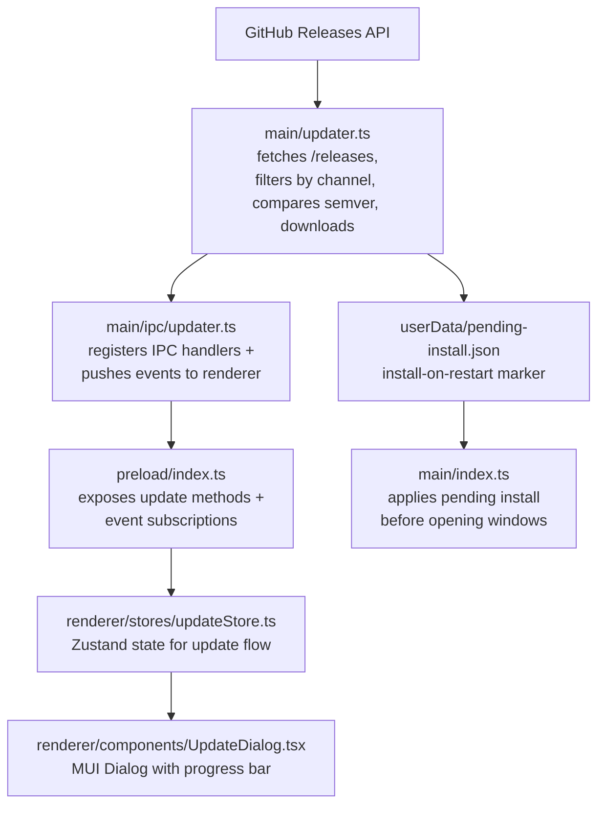

# 🔄 Update Manager

## 📖 Overview

EncodeX uses a custom in-app update manager. It queries the GitHub Releases API for the published releases, filters them by the update channel the running version belongs to, compares their semantic versions against the running app, selects the installer for the current platform and architecture, and downloads it in-app with progress reporting. When the download completes, the user can install and restart immediately or schedule the installer to run on the next app restart.

Updates are never installed silently or automatically. Every install is initiated by a user action, either from the update dialog or from the pending-install marker the user explicitly armed.

## 🏗️ Architecture

## 📁 Implementation Files

| File | Role |
|------|------|
| `src/main/updater.ts` | Release fetching, semver comparison, asset selection, download, checksum verification, installer launch, pending-install marker |
| `src/main/ipc/updater.ts` | IPC handler registration and update event forwarding |
| `src/shared/types.ts` | `UpdateInfo`, `UpdateAsset`, `UpdateProgress`, and `PendingInstall` interfaces |
| `src/shared/ipc-channels.ts` | Update IPC channel constants |
| `src/shared/log-constants.ts` | Update log message constants |
| `src/main/index.ts` | Runs `autoInstallPendingUpdate()` before creating the splash and main windows |
| `src/preload/index.ts` | Exposes update bridge methods and event subscriptions |
| `src/renderer/electron-api.d.ts` | Declares update API types on `ElectronAPI` |
| `src/renderer/stores/updateStore.ts` | Zustand store for update state, progress, and pending installs |
| `src/renderer/components/UpdateDialog.tsx` | Modal dialog for availability, download progress, and install choices |
| `src/renderer/styles/UpdateDialog.styles.ts` | Styled components for the update dialog |
| `src/renderer/pages/About.tsx` | "Check for updates" button and version display |
| `src/renderer/App.tsx` | Mounts `UpdateDialog` globally |
| `src/test-setup.ts`, `e2e/mocks/preload.js` | Update API mocks for unit and E2E tests |

## 🔌 IPC Channels

| Channel | Direction | Purpose |
|---------|-----------|---------|
| `check-for-updates` | renderer -> main | Trigger update check |
| `download-update` | renderer -> main | Start downloading the matched asset |
| `install-update` | renderer -> main | Launch the downloaded installer and quit |
| `cancel-download` | renderer -> main | Cancel in-progress download |
| `open-release-notes` | renderer -> main | Open the release page in the system browser |
| `schedule-install-on-restart` | renderer -> main | Persist a marker to install the downloaded update on the next restart |
| `cancel-install-on-restart` | renderer -> main | Remove the pending restart-install marker |
| `get-pending-install` | renderer -> main | Read the pending restart-install marker, if any |
| `update-available` | main -> renderer | Notify that a new version is available |
| `update-not-available` | main -> renderer | Notify that the app is up to date |
| `update-progress` | main -> renderer | Push download progress |
| `update-downloaded` | main -> renderer | Notify that the download completed |
| `update-error` | main -> renderer | Push an update error |

## 🔢 Version Comparison

- Follows semver 2.0.0 precedence, including pre-release identifiers.
- A leading `v` and `+build` metadata are ignored; build metadata does not affect precedence.
- Major, minor, and patch must be numeric; an unparseable version throws rather than being coerced.
- A stable version outranks a pre-release (`1.0.0` > `1.0.0-beta.1`).
- Pre-release identifiers compare dot-by-dot: numeric identifiers numerically, alphanumeric identifiers lexically, and numeric identifiers rank below alphanumeric ones.
- An update is offered only when the remote version is strictly greater than the running version.

## 📡 Update Channels

The channel is derived from the running version, and decides which releases are eligible:

| Channel | Running version | Eligible releases |
|---|---|---|
| `stable` | no pre-release identifier, e.g. `1.0.0` | stable releases only |
| `beta` | a pre-release identifier, e.g. `1.0.0-beta.5` | pre-releases *and* stable releases |

Consequences worth knowing:

- A beta build keeps receiving betas, and also receives the eventual stable `1.0.0` when it ships.
- A stable build is never offered a pre-release.
- A **draft** release is never offered to anyone. GitHub excludes drafts from the published release list, so a release left as a draft is invisible to the updater until it is published.
- GitHub's own "latest release" endpoint is deliberately *not* used: it resolves to the newest non-draft, non-prerelease release, which a beta build could never see past, and a beta published without the pre-release flag would be handed to stable users as if it were the stable release. The updater reads the release **list** and applies the channel filter itself.
- The release workflow marks a pre-release tag (`v1.0.0-beta.6`) as a GitHub pre-release, so the flag and the tag agree.

## 🎯 Asset Selection Logic

1. Accept only plain file names with the platform installer extension:
   - `win32` -> `.exe`
   - `darwin` -> `.dmg`
   - `linux` -> `.AppImage`
2. Reject names containing path separators, traversal segments, or NUL bytes.
3. Within the platform set, prefer an asset whose name contains the current `process.arch` (`x64`, `arm64`, `ia32`).
4. Fall back to the first platform-matched asset when no architecture match exists.
5. Pin download redirects to GitHub-owned hosts.

## 📥 Download and Install Flow

1. The renderer calls `check-for-updates`. The main process fetches `/releases?per_page=100` with a 15-second timeout, a 4 MB response cap, and at most 5 redirects, then filters the list by the update channel.
2. The matched asset is returned through `update-available`.
3. `download-update` streams the installer to `app.getPath('temp')/EncodeX-updater/`. Downloads abort after 60 seconds without a chunk; asset sizes above 4 GB in the release payload are treated as unknown.
4. Progress is pushed via `update-progress` at most about every 300 ms as `percent`, `transferred`, and `total`.
5. On completion the file must match the advertised `Content-Length` and, when the release publishes one, its SHA-256 or SHA-512 digest. A mismatch fails the download.
6. `update-downloaded` reports the installer path. The user can install and restart, schedule the install for the next restart, or close the dialog.
7. `install-update` re-validates that the path is an installer inside the update directory, launches it with `shell.openPath()`, and quits the app.
8. `schedule-install-on-restart` writes `userData/pending-install.json`. At the next startup, `autoInstallPendingUpdate()` clears the marker, re-validates the path and version, launches the installer, and quits before any window opens.

EncodeX releases are not code-signed or notarized. The digest check verifies integrity when GitHub publishes a digest; it does not establish publisher authenticity.

On Windows, launching the downloaded installer can trigger the SmartScreen warning "Windows protected your PC" with an "Unknown publisher" message. This is expected for an unsigned build and does not mean the download is corrupt; the user clicks **More info** and then **Run anyway**. SmartScreen cannot establish publisher authenticity either, because there is no code signature on the build. On macOS, the equivalent first-launch block comes from Gatekeeper, and the user right-clicks the app and chooses **Open** (or removes the quarantine flag with `xattr -cr /Applications/EncodeX.app`).

## 🖼️ UI States

| State | Dialog Shows |
|-------|-------------|
| `idle` | Dialog hidden |
| `checking` | Spinner + "Checking for updates..." |
| `available` | Version info, release notes link, Download button |
| `not-available` | "You're up to date" message, Close button |
| `downloading` | Determinate progress bar with percent and transferred/total bytes |
| `downloaded` | "Update ready to install" with Install & Restart and Install on Restart options |
| `restart-scheduled` | Notice that the update will install on the next restart, plus Cancel and Install & Restart |
| `error` | Error message + Retry / Close buttons |

## 🧪 Testing Strategy

- Unit: semver comparison, update-channel selection, asset selection, download validation, checksum handling, and the pending-install marker.
- Hostile-input tests: `src/main/__tests__/updater-hostile.test.ts` pins path traversal, redirect, truncated download, and digest-mismatch behavior.
- IPC tests: handler registration and event forwarding in `src/main/ipc/__tests__/updater.test.ts`.
- Manual: publish a test tag newer than `1.0.0-beta.5` as a **pre-release**, publish the draft so it leaves draft state, and verify check -> download -> install, plus the install-on-restart path. Then verify from a stable build that the same pre-release is *not* offered.
