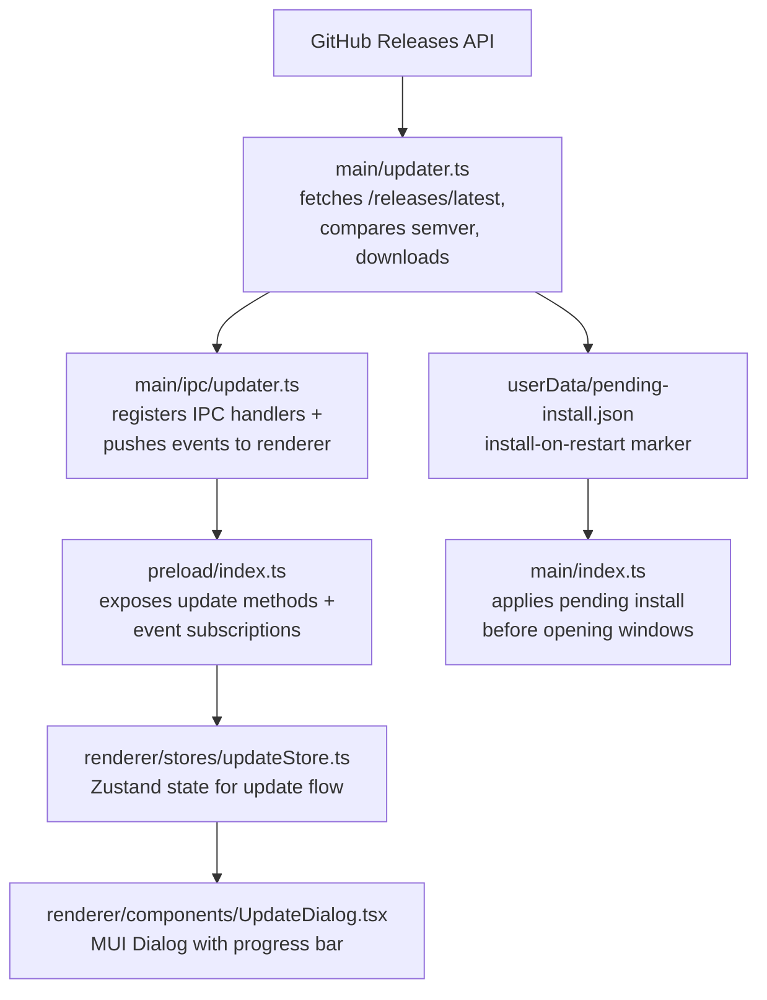

# Update-Manager

## Überblick

EncodeX verwendet einen eigenen integrierten Update-Manager. Er fragt die GitHub-Releases-API nach dem neuesten Release ab, vergleicht dessen semantische Version mit der laufenden App, wählt den Installer für die aktuelle Plattform und Architektur aus und lädt ihn in der App mit Fortschrittsanzeige herunter. Ist der Download abgeschlossen, kann der Benutzer sofort installieren und neu starten oder den Installer so einplanen, dass er beim nächsten App-Neustart ausgeführt wird.

Updates werden niemals stillschweigend oder automatisch installiert. Jede Installation wird durch eine Benutzeraktion ausgelöst – entweder aus dem Update-Dialog oder über die Pending-Install-Markierung, die der Benutzer ausdrücklich aktiviert hat.

## Architektur

## Implementierungsdateien

| Datei | Rolle |
|------|------|
| `src/main/updater.ts` | Release-Abruf, Semver-Vergleich, Asset-Auswahl, Download, Prüfsummen-Verifikation, Installer-Start, Pending-Install-Markierung |
| `src/main/ipc/updater.ts` | Registrierung der IPC-Handler und Weiterleitung der Update-Events |
| `src/shared/types.ts` | Interfaces `UpdateInfo`, `UpdateAsset`, `UpdateProgress` und `PendingInstall` |
| `src/shared/ipc-channels.ts` | Konstanten der Update-IPC-Kanäle |
| `src/shared/log-constants.ts` | Konstanten für Update-Log-Meldungen |
| `src/main/index.ts` | Führt `autoInstallPendingUpdate()` aus, bevor Splash- und Hauptfenster erstellt werden |
| `src/preload/index.ts` | Stellt Update-Brückenmethoden und Event-Abos bereit |
| `src/renderer/electron-api.d.ts` | Deklariert die Update-API-Typen auf `ElectronAPI` |
| `src/renderer/stores/updateStore.ts` | Zustand-Store für Update-Zustand, Fortschritt und ausstehende Installationen |
| `src/renderer/components/UpdateDialog.tsx` | Modaler Dialog für Verfügbarkeit, Download-Fortschritt und Installationsoptionen |
| `src/renderer/styles/UpdateDialog.styles.ts` | Gestylte Komponenten für den Update-Dialog |
| `src/renderer/pages/About.tsx` | Button „Nach Updates suchen" und Versionsanzeige |
| `src/renderer/App.tsx` | Mountet `UpdateDialog` global |
| `src/test-setup.ts`, `e2e/mocks/preload.js` | Update-API-Mocks für Unit- und E2E-Tests |

## IPC-Kanäle

| Channel | Richtung | Zweck |
|---------|-----------|---------|
| `check-for-updates` | renderer -> main | Updatesuche auslösen |
| `download-update` | renderer -> main | Download des passenden Assets starten |
| `install-update` | renderer -> main | Heruntergeladenen Installer starten und die App beenden |
| `cancel-download` | renderer -> main | Laufenden Download abbrechen |
| `open-release-notes` | renderer -> main | Release-Seite im Systembrowser öffnen |
| `schedule-install-on-restart` | renderer -> main | Markierung speichern, um das heruntergeladene Update beim nächsten Neustart zu installieren |
| `cancel-install-on-restart` | renderer -> main | Markierung für die Installation beim Neustart entfernen |
| `get-pending-install` | renderer -> main | Markierung für die Installation beim Neustart lesen, falls vorhanden |
| `update-available` | main -> renderer | Melden, dass eine neue Version verfügbar ist |
| `update-not-available` | main -> renderer | Melden, dass die App auf dem neuesten Stand ist |
| `update-progress` | main -> renderer | Download-Fortschritt senden |
| `update-downloaded` | main -> renderer | Melden, dass der Download abgeschlossen ist |
| `update-error` | main -> renderer | Update-Fehler senden |

## Versionsvergleich

- Folgt der Semver-Präzedenz 2.0.0, einschließlich Pre-Release-Kennungen.
- Ein führendes `v` und `+build`-Metadaten werden ignoriert; Build-Metadaten beeinflussen die Präzedenz nicht.
- Major, Minor und Patch müssen numerisch sein; eine nicht parsebare Version löst einen Fehler aus, statt stillschweigend konvertiert zu werden.
- Eine stabile Version schlägt eine Pre-Release-Version (`1.0.0` > `1.0.0-beta.1`).
- Pre-Release-Kennungen werden Punkt für Punkt verglichen: numerische Kennungen numerisch, alphanumerische Kennungen lexikalisch, und numerische Kennungen rangieren unter den alphanumerischen.
- Ein Update wird nur angeboten, wenn die Remote-Version strikt größer als die laufende Version ist.

## Asset-Auswahllogik

1. Nur einfache Dateinamen mit der Installer-Endung der Plattform akzeptieren:
   - `win32` -> `.exe`
   - `darwin` -> `.dmg`
   - `linux` -> `.AppImage`
2. Namen mit Pfadtrennern, Traversal-Segmenten oder NUL-Bytes ablehnen.
3. Innerhalb der Plattformmenge bevorzugt ein Asset wählen, dessen Name das aktuelle `process.arch` (`x64`, `arm64`, `ia32`) enthält.
4. Auf das erste plattformpassende Asset zurückfallen, wenn kein Architektur-Match existiert.
5. Download-Weiterleitungen auf GitHub-eigene Hosts festnageln.

## Download- und Installationsablauf

1. Der Renderer ruft `check-for-updates` auf. Der Hauptprozess holt `/releases/latest` mit einem Timeout von 15 Sekunden, einem Antwort-Limit von 4 MB und höchstens 5 Weiterleitungen.
2. Das passende Asset wird über `update-available` zurückgegeben.
3. `download-update` streamt den Installer nach `app.getPath('temp')/EncodeX-updater/`. Downloads werden nach 60 Sekunden ohne Chunk abgebrochen; Asset-Größen über 4 GB in den Release-Daten gelten als unbekannt.
4. Der Fortschritt wird über `update-progress` höchstens etwa alle 300 ms als `percent`, `transferred` und `total` gesendet.
5. Beim Abschluss muss die Datei der angegebenen `Content-Length` entsprechen und – sofern das Release einen Digest veröffentlicht – ihrem SHA-256- oder SHA-512-Digest. Eine Abweichung lässt den Download fehlschlagen.
6. `update-downloaded` meldet den Pfad des Installers. Der Benutzer kann installieren und neu starten, die Installation für den nächsten Neustart einplanen oder den Dialog schließen.
7. `install-update` validiert erneut, dass der Pfad ein Installer innerhalb des Update-Verzeichnisses ist, startet ihn mit `shell.openPath()` und beendet die App.
8. `schedule-install-on-restart` schreibt `userData/pending-install.json`. Beim nächsten Start löscht `autoInstallPendingUpdate()` die Markierung, validiert Pfad und Version erneut, startet den Installer und beendet die App, bevor ein Fenster geöffnet wird.

EncodeX-Releases sind nicht code-signiert und nicht notarisiert. Die Digest-Prüfung verifiziert die Integrität, wenn GitHub einen Digest veröffentlicht; sie belegt nicht die Authentizität des Herausgebers.

## UI-Zustände

| Zustand | Was der Dialog zeigt |
|-------|-------------|
| `idle` | Dialog verborgen |
| `checking` | Spinner + „Suche nach Updates..." |
| `available` | Versionsinfo, Release-Notes-Link, Download-Button |
| `not-available` | Meldung „Du bist auf dem neuesten Stand", Schließen-Button |
| `downloading` | Bestimmter Fortschrittsbalken mit Prozent und übertragenen/gesamten Bytes |
| `downloaded` | „Update bereit zur Installation" mit den Optionen „Installieren & neu starten" und „Beim Neustart installieren" |
| `restart-scheduled` | Hinweis, dass das Update beim nächsten Neustart installiert wird, sowie Abbrechen und „Installieren & neu starten" |
| `error` | Fehlermeldung + Wiederholen-/Schließen-Buttons |

## Teststrategie

- Unit: Semver-Vergleich, Asset-Auswahl, Download-Validierung, Prüfsummen-Behandlung und die Pending-Install-Markierung.
- Tests mit feindlichen Eingaben: `src/main/__tests__/updater-hostile.test.ts` fixiert das Verhalten bei Path-Traversal, Weiterleitungen, abgebrochenen Downloads und Digest-Abweichungen.
- IPC-Tests: Handler-Registrierung und Event-Weiterleitung in `src/main/ipc/__tests__/updater.test.ts`.
- Manuell: ein Test-Tag veröffentlichen, der neuer als `1.0.0-beta.5` ist, und Suche -> Download -> Installation sowie den Ablauf „Installation beim Neustart" prüfen.
