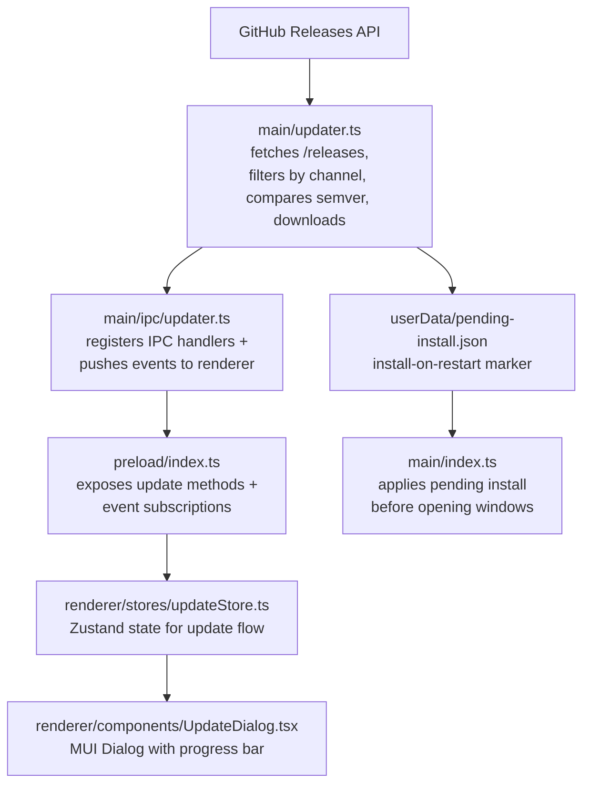

# Gestor de actualizaciones

## Resumen

EncodeX usa un gestor de actualizaciones personalizado integrado en la app. Consulta la API de GitHub Releases para obtener las releases publicadas, las filtra por el canal de actualización al que pertenece la versión en ejecución, compara sus versiones semánticas con la de la app en ejecución, selecciona el instalador para la plataforma y arquitectura actuales, y lo descarga dentro de la app con reporte de progreso. Cuando la descarga termina, el usuario puede instalar y reiniciar de inmediato o programar el instalador para el siguiente reinicio de la app.

Las actualizaciones nunca se instalan en silencio ni de forma automática. Cada instalación la inicia una acción del usuario, ya sea desde el diálogo de actualización o desde el marcador de instalación pendiente que el usuario activa explícitamente.

## Arquitectura

## Archivos de implementación

| Archivo | Función |
|------|---------|
| `src/main/updater.ts` | Obtención de releases, comparación semver, selección de assets, descarga, verificación de checksums, lanzamiento del instalador y marcador de instalación pendiente |
| `src/main/ipc/updater.ts` | Registro de manejadores IPC y reenvío de eventos de actualización |
| `src/shared/types.ts` | Interfaces `UpdateInfo`, `UpdateAsset`, `UpdateProgress` y `PendingInstall` |
| `src/shared/ipc-channels.ts` | Constantes de los canales IPC de actualización |
| `src/shared/log-constants.ts` | Constantes de mensajes de log de actualización |
| `src/main/index.ts` | Ejecuta `autoInstallPendingUpdate()` antes de crear las ventanas splash y principal |
| `src/preload/index.ts` | Expone los métodos del puente de actualización y las suscripciones a eventos |
| `src/renderer/electron-api.d.ts` | Declara los tipos de la API de actualización en `ElectronAPI` |
| `src/renderer/stores/updateStore.ts` | Store Zustand para el estado de actualización, el progreso y las instalaciones pendientes |
| `src/renderer/components/UpdateDialog.tsx` | Diálogo modal para la disponibilidad, el progreso de descarga y las opciones de instalación |
| `src/renderer/styles/UpdateDialog.styles.ts` | Componentes con estilo para el diálogo de actualización |
| `src/renderer/pages/About.tsx` | Botón "Buscar actualizaciones" y visualización de la versión |
| `src/renderer/App.tsx` | Monta `UpdateDialog` de forma global |
| `src/test-setup.ts`, `e2e/mocks/preload.js` | Mocks de la API de actualización para las pruebas unitarias y E2E |

## Canales IPC

| Canal | Dirección | Propósito |
|---------|-----------|---------|
| `check-for-updates` | renderer -> main | Iniciar la búsqueda de actualizaciones |
| `download-update` | renderer -> main | Iniciar la descarga del asset coincidente |
| `install-update` | renderer -> main | Lanzar el instalador descargado y cerrar la app |
| `cancel-download` | renderer -> main | Cancelar la descarga en curso |
| `open-release-notes` | renderer -> main | Abrir la página del release en el navegador del sistema |
| `schedule-install-on-restart` | renderer -> main | Guardar un marcador para instalar la actualización descargada en el siguiente reinicio |
| `cancel-install-on-restart` | renderer -> main | Eliminar el marcador de instalación pendiente al reiniciar |
| `get-pending-install` | renderer -> main | Leer el marcador de instalación al reiniciar, si existe |
| `update-available` | main -> renderer | Notificar que hay una versión nueva disponible |
| `update-not-available` | main -> renderer | Notificar que la app está al día |
| `update-progress` | main -> renderer | Enviar el progreso de descarga |
| `update-downloaded` | main -> renderer | Notificar que la descarga terminó |
| `update-error` | main -> renderer | Enviar un error de actualización |

## Comparación de versiones

- Sigue la precedencia de semver 2.0.0, incluidos los identificadores de pre-release.
- Un `v` inicial y los metadatos de build `+build` se ignoran; los metadatos de build no afectan a la precedencia.
- Major, minor y patch deben ser numéricos; una versión no interpretable lanza un error en lugar de convertirse.
- Una versión estable tiene prioridad sobre una pre-release (`1.0.0` > `1.0.0-beta.1`).
- Los identificadores de pre-release se comparan punto a punto: los numéricos numéricamente, los alfanuméricos léxicamente, y los numéricos se sitúan por debajo de los alfanuméricos.
- Solo se ofrece una actualización cuando la versión remota es estrictamente mayor que la versión en ejecución.

## Canales de actualización

El canal se deriva de la versión en ejecución y decide qué releases son elegibles:

| Canal | Versión en ejecución | Releases elegibles |
|---|---|---|
| `stable` | sin identificador de pre-release, p. ej. `1.0.0` | solo releases estables |
| `beta` | con un identificador de pre-release, p. ej. `1.0.0-beta.5` | pre-releases *y* releases estables |

Consecuencias que conviene conocer:

- Una compilación beta sigue recibiendo betas y además recibe el `1.0.0` estable cuando se publique.
- A una compilación estable nunca se le ofrece una pre-release.
- Una release **borrador** nunca se le ofrece a nadie. GitHub excluye los borradores de la lista de releases publicadas, así que una release que se deje como borrador es invisible para el actualizador hasta que se publique.
- El endpoint propio de GitHub de «última release» no se usa deliberadamente: resuelve a la release más reciente que no sea borrador ni pre-release, que una compilación beta nunca podría superar, y una beta publicada sin la marca de pre-release se entregaría a los usuarios estables como si fuera la release estable. El actualizador lee la **lista** de releases y aplica él mismo el filtro de canal.
- El flujo de trabajo de release marca un tag de pre-release (`v1.0.0-beta.6`) como pre-release de GitHub, de modo que la marca y el tag coinciden.

## Lógica de selección de assets

1. Aceptar solo nombres de archivo simples con la extensión del instalador de la plataforma:
   - `win32` -> `.exe`
   - `darwin` -> `.dmg`
   - `linux` -> `.AppImage`
2. Rechazar nombres que contengan separadores de ruta, segmentos de recorrido o bytes NUL.
3. Dentro del conjunto de la plataforma, preferir un asset cuyo nombre contenga el `process.arch` actual (`x64`, `arm64`, `ia32`).
4. Recurrir al primer asset que coincida con la plataforma si no hay coincidencia de arquitectura.
5. Fijar las redirecciones de descarga a hosts propiedad de GitHub.

## Flujo de descarga e instalación

1. El renderer invoca `check-for-updates`. El proceso principal consulta `/releases?per_page=100` con un timeout de 15 segundos, un límite de respuesta de 4 MB y como máximo 5 redirecciones, y luego filtra la lista por el canal de actualización.
2. El asset coincidente se devuelve mediante `update-available`.
3. `download-update` transmite el instalador a `app.getPath('temp')/EncodeX-updater/`. Las descargas se abortan si pasan 60 segundos sin recibir ningún fragmento; los tamaños de asset superiores a 4 GB en la carga del release se tratan como desconocidos.
4. El progreso se envía mediante `update-progress` como máximo cada ~300 ms, con `percent`, `transferred` y `total`.
5. Al terminar, el archivo debe coincidir con el `Content-Length` anunciado y, cuando el release publica uno, con su digest SHA-256 o SHA-512. Si no coincide, la descarga falla.
6. `update-downloaded` informa de la ruta del instalador. El usuario puede instalar y reiniciar, programar la instalación para el siguiente reinicio o cerrar el diálogo.
7. `install-update` vuelve a validar que la ruta es un instalador dentro del directorio de actualizaciones, lo lanza con `shell.openPath()` y cierra la app.
8. `schedule-install-on-restart` escribe `userData/pending-install.json`. En el siguiente arranque, `autoInstallPendingUpdate()` elimina el marcador, vuelve a validar la ruta y la versión, lanza el instalador y cierra la app antes de abrir ninguna ventana.

Las versiones de EncodeX no están firmadas con código ni notarizadas. La comprobación del digest verifica la integridad cuando GitHub publica un digest; no establece la autenticidad del editor.

En Windows, al iniciar el instalador descargado puede aparecer la advertencia de SmartScreen "Windows protected your PC" con el mensaje "Editor desconocido". Es algo previsto en una compilación sin firmar y no significa que la descarga esté dañada; el usuario hace clic en **Más información** y luego en **Ejecutar de todas formas**. SmartScreen tampoco puede establecer la autenticidad del editor, porque la compilación no lleva firma de código. En macOS, el bloqueo equivalente al primer inicio viene de Gatekeeper: haz clic derecho en la app y elige **Abrir** (o elimina la cuarentena con `xattr -cr /Applications/EncodeX.app`).

## Estados de la UI

| Estado | Qué muestra el diálogo |
|-------|-------------|
| `idle` | Diálogo oculto |
| `checking` | Spinner + "Buscando actualizaciones..." |
| `available` | Información de versión, enlace a las notas del release, botón Descargar |
| `not-available` | Mensaje "Ya estás al día", botón Cerrar |
| `downloading` | Barra de progreso determinada con porcentaje y bytes transferidos/totales |
| `downloaded` | "Actualización lista para instalar" con las opciones Instalar y reiniciar e Instalar al reiniciar |
| `restart-scheduled` | Aviso de que la actualización se instalará en el siguiente reinicio, más Cancelar e Instalar y reiniciar |
| `error` | Mensaje de error + botones Reintentar / Cerrar |

## Estrategia de pruebas

- Unitarias: comparación semver, selección de canal de actualización, selección de assets, validación de descargas, gestión de checksums y el marcador de instalación pendiente.
- Pruebas de entradas hostiles: `src/main/__tests__/updater-hostile.test.ts` fija el comportamiento ante recorridos de ruta, redirecciones, descargas truncadas y digests que no coinciden.
- Pruebas de IPC: registro de manejadores y reenvío de eventos en `src/main/ipc/__tests__/updater.test.ts`.
- Manual: publicar un tag de prueba más nuevo que `1.0.0-beta.5` como **pre-release**, publicar el borrador para que salga del estado de borrador y verificar búsqueda -> descarga -> instalación, además de la ruta de instalación al reiniciar. A continuación, verificar desde una compilación estable que esa misma pre-release *no* se ofrece.
