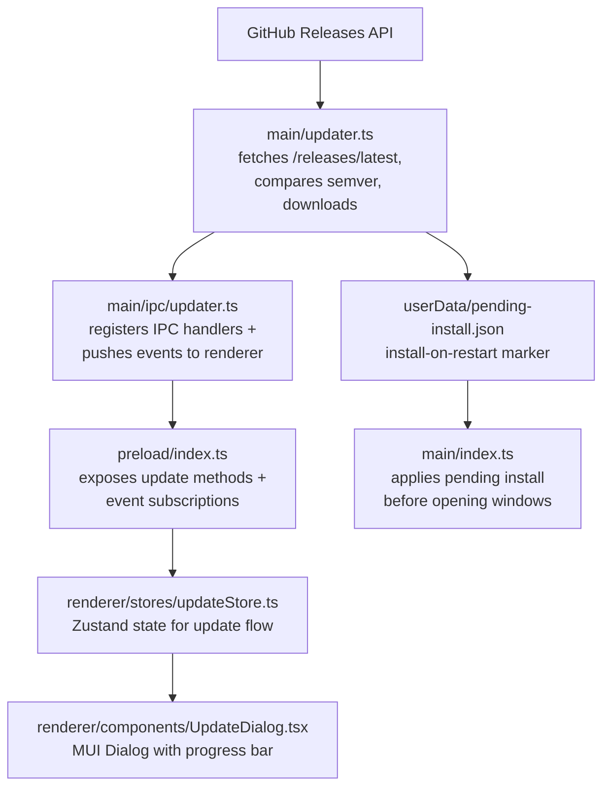

# Gestionnaire de mises à jour

## Aperçu

EncodeX utilise un gestionnaire de mises à jour intégré et personnalisé. Il interroge l'API GitHub Releases pour la dernière release, compare sa version sémantique à celle de l'application en cours, sélectionne l'installateur correspondant à la plateforme et à l'architecture actuelles, et le télécharge dans l'app avec un suivi de progression. Une fois le téléchargement terminé, l'utilisateur peut installer et redémarrer immédiatement, ou programmer l'installation pour le prochain redémarrage de l'application.

Les mises à jour ne sont jamais installées silencieusement ni automatiquement. Chaque installation est déclenchée par une action de l'utilisateur, soit depuis le dialogue de mise à jour, soit depuis le marqueur d'installation en attente que l'utilisateur a explicitement armé.

## Architecture

## Fichiers d'implémentation

| Fichier | Rôle |
|------|------|
| `src/main/updater.ts` | Récupération des releases, comparaison semver, sélection des assets, téléchargement, vérification de somme de contrôle, lancement de l'installateur, marqueur d'installation en attente |
| `src/main/ipc/updater.ts` | Enregistrement des gestionnaires IPC et relais des événements de mise à jour |
| `src/shared/types.ts` | Interfaces `UpdateInfo`, `UpdateAsset`, `UpdateProgress` et `PendingInstall` |
| `src/shared/ipc-channels.ts` | Constantes des canaux IPC de mise à jour |
| `src/shared/log-constants.ts` | Constantes des messages de log de mise à jour |
| `src/main/index.ts` | Exécute `autoInstallPendingUpdate()` avant la création des fenêtres splash et principale |
| `src/preload/index.ts` | Expose les méthodes du pont de mise à jour et les abonnements aux événements |
| `src/renderer/electron-api.d.ts` | Déclare les types de l'API de mise à jour sur `ElectronAPI` |
| `src/renderer/stores/updateStore.ts` | Store Zustand pour l'état de mise à jour, la progression et les installations en attente |
| `src/renderer/components/UpdateDialog.tsx` | Dialogue modal pour la disponibilité, la progression du téléchargement et les choix d'installation |
| `src/renderer/styles/UpdateDialog.styles.ts` | Composants stylés pour le dialogue de mise à jour |
| `src/renderer/pages/About.tsx` | Bouton « Rechercher des mises à jour » et affichage de la version |
| `src/renderer/App.tsx` | Monte `UpdateDialog` globalement |
| `src/test-setup.ts`, `e2e/mocks/preload.js` | Mocks de l'API de mise à jour pour les tests unitaires et E2E |

## Canaux IPC

| Channel | Direction | Objectif |
|---------|-----------|---------|
| `check-for-updates` | renderer -> main | Déclencher la recherche de mises à jour |
| `download-update` | renderer -> main | Démarrer le téléchargement de l'asset correspondant |
| `install-update` | renderer -> main | Lancer l'installateur téléchargé et quitter l'app |
| `cancel-download` | renderer -> main | Annuler le téléchargement en cours |
| `open-release-notes` | renderer -> main | Ouvrir la page du release dans le navigateur système |
| `schedule-install-on-restart` | renderer -> main | Persister un marqueur pour installer la mise à jour téléchargée au prochain redémarrage |
| `cancel-install-on-restart` | renderer -> main | Supprimer le marqueur d'installation au redémarrage |
| `get-pending-install` | renderer -> main | Lire le marqueur d'installation au redémarrage, s'il existe |
| `update-available` | main -> renderer | Notifier qu'une nouvelle version est disponible |
| `update-not-available` | main -> renderer | Notifier que l'app est à jour |
| `update-progress` | main -> renderer | Pousser la progression du téléchargement |
| `update-downloaded` | main -> renderer | Notifier que le téléchargement est terminé |
| `update-error` | main -> renderer | Pousser une erreur de mise à jour |

## Comparaison de versions

- Suit la précédence semver 2.0.0, y compris les identifiants de pre-release.
- Un `v` initial et les métadonnées de build `+build` sont ignorés ; les métadonnées de build n'affectent pas la précédence.
- Majeure, mineure et correctif doivent être numériques ; une version non analysable lève une erreur au lieu d'être convertie.
- Une version stable l'emporte sur une pre-release (`1.0.0` > `1.0.0-beta.1`).
- Les identifiants de pre-release se comparent point par point : les identifiants numériques numériquement, les identifiants alphanumériques lexicalement, et les identifiants numériques sont classés sous les alphanumériques.
- Une mise à jour n'est proposée que si la version distante est strictement supérieure à la version en cours.

## Logique de sélection des assets

1. N'accepter que les noms de fichiers simples avec l'extension d'installateur de la plateforme :
   - `win32` -> `.exe`
   - `darwin` -> `.dmg`
   - `linux` -> `.AppImage`
2. Rejeter les noms contenant des séparateurs de chemin, des segments de traversée ou des octets NUL.
3. Au sein de l'ensemble de la plateforme, privilégier un asset dont le nom contient le `process.arch` courant (`x64`, `arm64`, `ia32`).
4. Revenir au premier asset correspondant à la plateforme si aucune architecture ne correspond.
5. Épingler les redirections de téléchargement aux hôtes détenus par GitHub.

## Flux de téléchargement et d'installation

1. Le renderer appelle `check-for-updates`. Le processus principal interroge `/releases/latest` avec un timeout de 15 secondes, une limite de réponse de 4 Mo et au plus 5 redirections.
2. L'asset correspondant est renvoyé via `update-available`.
3. `download-update` diffuse l'installateur vers `app.getPath('temp')/EncodeX-updater/`. Les téléchargements sont interrompus après 60 secondes sans chunk ; les tailles d'assets supérieures à 4 Go dans la charge utile de la release sont traitées comme inconnues.
4. La progression est poussée via `update-progress` au plus toutes les 300 ms environ, sous forme de `percent`, `transferred` et `total`.
5. À la fin, le fichier doit correspondre au `Content-Length` annoncé et, lorsque la release publie un condensé SHA-256 ou SHA-512, à ce condensé. Une incohérence fait échouer le téléchargement.
6. `update-downloaded` indique le chemin de l'installateur. L'utilisateur peut installer et redémarrer, programmer l'installation pour le prochain redémarrage, ou fermer le dialogue.
7. `install-update` revalide que le chemin est un installateur situé dans le répertoire de mise à jour, le lance avec `shell.openPath()` et quitte l'app.
8. `schedule-install-on-restart` écrit `userData/pending-install.json`. Au démarrage suivant, `autoInstallPendingUpdate()` supprime le marqueur, revalide le chemin et la version, lance l'installateur et quitte avant l'ouverture de toute fenêtre.

Les releases EncodeX ne sont pas signées ni notariées. La vérification du condensé garantit l'intégrité lorsque GitHub publie un condensé ; elle n'établit pas l'authenticité de l'éditeur.

## États de l'UI

| État      | Ce que montre le dialogue |
|-------|-------------|
| `idle` | Dialogue masqué |
| `checking` | Spinner + « Recherche de mises à jour... » |
| `available` | Infos de version, lien vers les notes de release, bouton Télécharger |
| `not-available` | Message « Vous êtes à jour », bouton Fermer |
| `downloading` | Barre de progression déterminée avec pourcentage et octets transférés/totaux |
| `downloaded` | « Mise à jour prête à installer » avec les options Installer et redémarrer et Installer au redémarrage |
| `restart-scheduled` | Avis indiquant que la mise à jour sera installée au prochain redémarrage, plus Annuler et Installer et redémarrer |
| `error` | Message d'erreur + boutons Réessayer / Fermer |

## Stratégie de test

- Unitaires : comparaison semver, sélection des assets, validation du téléchargement, gestion des sommes de contrôle et marqueur d'installation en attente.
- Tests d'entrées hostiles : `src/main/__tests__/updater-hostile.test.ts` verrouille le comportement face à la traversée de chemin, aux redirections, aux téléchargements tronqués et aux condensés non concordants.
- Tests IPC : enregistrement des gestionnaires et relais des événements dans `src/main/ipc/__tests__/updater.test.ts`.
- Manuels : publier un tag de test plus récent que `1.0.0-beta.5` et vérifier le flux recherche -> téléchargement -> installation, ainsi que le chemin d'installation au redémarrage.
