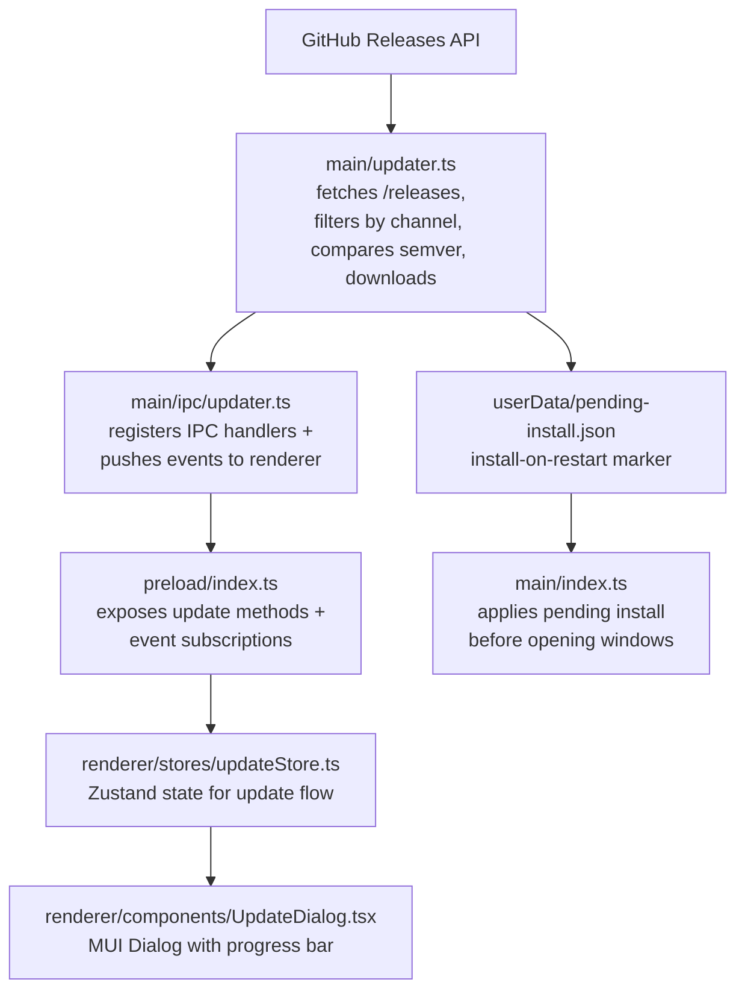

# अपडेट मैनेजर

## Overview

EncodeX एक कस्टम इन-ऐप अपडेट मैनेजर का उपयोग करता है। यह GitHub Releases API से published releases पूछता है, उन्हें चल रहे version के update channel के अनुसार filter करता है, उनके semantic versions की तुलना चल रहे ऐप से करता है, वर्तमान प्लेटफ़ॉर्म और आर्किटेक्चर के लिए installer चुनता है, और उसे in-app real-time progress reporting के साथ download करता है। Download पूरा होने पर उपयोगकर्ता तुरंत install और restart कर सकता है, या अगले ऐप restart पर installer चलाने का शेड्यूल कर सकता है।

अपडेट कभी चुपचाप या अपने-आप install नहीं होते। हर install किसी उपयोगकर्ता क्रिया से शुरू होता है — या तो update dialog से, या उस pending-install marker से जिसे उपयोगकर्ता ने स्पष्ट रूप से सेट किया हो।

## Architecture

## Implementation files

| File | Role |
|------|------|
| `src/main/updater.ts` | Release fetching, semver comparison, asset selection, download, checksum verification, installer launch, pending-install marker |
| `src/main/ipc/updater.ts` | IPC handler registration and update event forwarding |
| `src/shared/types.ts` | `UpdateInfo`, `UpdateAsset`, `UpdateProgress`, and `PendingInstall` interfaces |
| `src/shared/ipc-channels.ts` | Update IPC channel constants |
| `src/shared/log-constants.ts` | Update log message constants |
| `src/main/index.ts` | Runs `autoInstallPendingUpdate()` before creating the splash and main windows |
| `src/preload/index.ts` | Exposes update bridge methods and event subscriptions |
| `src/renderer/electron-api.d.ts` | Declares update API types on `ElectronAPI` |
| `src/renderer/stores/updateStore.ts` | Zustand store for update state, progress, and pending installs |
| `src/renderer/components/UpdateDialog.tsx` | Modal dialog for availability, download progress, and install choices |
| `src/renderer/pages/About.tsx` | "Check for updates" button and version display |
| `src/renderer/App.tsx` | Mounts `UpdateDialog` globally |
| `src/test-setup.ts`, `e2e/mocks/preload.js` | Update API mocks for unit and E2E tests |

## IPC channels

| Channel | Direction | Purpose |
|---------|-----------|---------|
| `check-for-updates` | renderer -> main | Trigger an update check |
| `download-update` | renderer -> main | Start downloading the matched asset |
| `install-update` | renderer -> main | Launch the downloaded installer and quit |
| `cancel-download` | renderer -> main | Abort an in-progress download |
| `open-release-notes` | renderer -> main | Open the release page in the system browser |
| `schedule-install-on-restart` | renderer -> main | Persist a marker to install the downloaded update on the next restart |
| `cancel-install-on-restart` | renderer -> main | Remove the pending restart-install marker |
| `get-pending-install` | renderer -> main | Read the pending restart-install marker, if any |
| `update-available` | main -> renderer | Notify that a newer version exists |
| `update-not-available` | main -> renderer | Notify that the app is up to date |
| `update-progress` | main -> renderer | Push download progress |
| `update-downloaded` | main -> renderer | Notify that the download completed |
| `update-error` | main -> renderer | Push an update failure |

## Version comparison

- Semver 2.0.0 precedence के अनुसार, pre-release identifiers सहित, तुलना होती है।
- Leading `v` और `+build` metadata अनदेखे किए जाते हैं; build metadata precedence को प्रभावित नहीं करता।
- Major, minor और patch अंकीय होने चाहिए; न पढ़ा जा सकने वाला version coerce होने के बजाय throw करता है।
- Stable version pre-release से ऊपर होता है (`1.0.0` > `1.0.0-beta.1`)।
- Pre-release identifiers dot-by-dot तुलना होते हैं: अंकीय identifiers संख्यात्मक रूप से, अक्षरांकीय identifiers lexically, और अंकीय identifiers अक्षरांकीय से नीचे रैंक होते हैं।
- अपडेट केवल तभी offer होता है जब remote version चल रहे version से strictly बड़ा हो।

## Update channels

Channel चल रहे version से derive होता है और यह तय करता है कि कौन-सी releases eligible हैं:

| Channel | चल रहा version | Eligible releases |
|---|---|---|
| `stable` | कोई pre-release identifier नहीं, जैसे `1.0.0` | केवल stable releases |
| `beta` | एक pre-release identifier, जैसे `1.0.0-beta.5` | pre-releases *और* stable releases |

जानने योग्य परिणाम:

- Beta build को betas मिलते रहते हैं, और stable `1.0.0` आने पर उसे वह भी मिल जाता है।
- Stable build को कभी कोई pre-release offer नहीं होता।
- **Draft** release किसी को भी offer नहीं होता। GitHub published release list से drafts को बाहर रखता है, इसलिए draft में छोड़ा गया release updater के लिए publish होने तक अदृश्य रहता है।
- GitHub का अपना "latest release" endpoint जानबूझकर *नहीं* इस्तेमाल किया जाता: यह सबसे नया non-draft, non-prerelease release पर resolve होता है, जिसे कोई beta build कभी पार नहीं कर सकता, और बिना pre-release flag के publish किया गया beta stable users को stable release की तरह मिल जाएगा। Updater release की **list** पढ़ता है और channel filter खुद लागू करता है।
- Release workflow एक pre-release tag (`v1.0.0-beta.6`) को GitHub pre-release के रूप में चिह्नित करता है, ताकि flag और tag आपस में मेल खाएँ।

## Asset selection logic

1. केवल सादे फ़ाइल नाम जिनमें प्लेटफ़ॉर्म का installer extension हो, स्वीकार करें:
   - `win32` -> `.exe`
   - `darwin` -> `.dmg`
   - `linux` -> `.AppImage`
2. फ़ाइल नाम जिनमें path separators, traversal segments या NUL bytes हों, अस्वीकार करें।
3. प्लेटफ़ॉर्म सेट के भीतर ऐसा asset प्राथमिकता दें जिसके नाम में वर्तमान `process.arch` (`x64`, `arm64`, `ia32`) हो।
4. कोई architecture match न होने पर प्लेटफ़ॉर्म से मेल खाने वाले पहले asset पर वापस जाएँ।
5. Download redirects को GitHub-owned hosts तक सीमित रखें।

## Download and install flow

1. Renderer `check-for-updates` call करता है। Main process `/releases?per_page=100` को 15-सेकंड timeout, 4 MB response cap और अधिकतम 5 redirects के साथ fetch करता है और फिर list को update channel के अनुसार filter करता है।
2. मेल खाने वाला asset `update-available` के माध्यम से लौटाया जाता है।
3. `download-update` installer को `app.getPath('temp')/EncodeX-updater/` में stream करता है। 60 सेकंड तक कोई chunk न आने पर download abort होता है; release payload में 4 GB से बड़े asset sizes को unknown माना जाता है।
4. Progress `update-progress` के माध्यम से लगभग हर 300 ms में `percent`, `transferred` और `total` के रूप में भेजी जाती है।
5. पूरा होने पर फ़ाइल advertised `Content-Length` से मेल खानी चाहिए और, यदि release उसे प्रकाशित करे, तो उसके SHA-256 या SHA-512 digest से भी। Mismatch होने पर download विफल होता है।
6. `update-downloaded` installer path रिपोर्ट करता है। उपयोगकर्ता install और restart कर सकता है, install को अगले restart के लिए शेड्यूल कर सकता है, या dialog बंद कर सकता है।
7. `install-update` जाँचता है कि path update directory के भीतर एक installer है, उसे `shell.openPath()` से launch करता है, और ऐप quit करता है।
8. `schedule-install-on-restart` `userData/pending-install.json` लिखता है। अगले startup पर `autoInstallPendingUpdate()` marker हटाता है, path और version फिर से validate करता है, installer launch करता है, और कोई window खुलने से पहले quit करता है।

EncodeX releases code-signed या notarized नहीं हैं। Digest check तब integrity सत्यापित करता है जब GitHub digest प्रकाशित करता है; यह publisher की authenticity स्थापित नहीं करता।

Windows पर डाउनलोड किया गया इंस्टॉलर चलाने पर SmartScreen "Windows protected your PC" चेतावनी के साथ "Unknown publisher" संदेश दिखा सकता है। unsigned build के लिए यह अपेक्षित है और इसका मतलब नहीं कि डाउनलोड खराब है; उपयोगकर्ता **More info** और फिर **Run anyway** पर क्लिक करता है। बिल्ड में code signature न होने के कारण SmartScreen भी publisher की authenticity स्थापित नहीं कर सकता। macOS पर पहली बार चलाने पर यही अवरोध Gatekeeper देता है: ऐप पर right-click करके **Open** चुनें (या `xattr -cr /Applications/EncodeX.app` से quarantine हटाएँ)।

## UI states

| State        | Dialog shows |
|--------------|--------------|
| `idle` | Dialog hidden |
| `checking` | Spinner + "Checking for updates..." |
| `available` | Version info, release notes link, Download button |
| `not-available` | "You're up to date" message, Close button |
| `downloading` | Determinate progress bar with percent and transferred/total bytes |
| `downloaded` | "Update ready to install" with Install & Restart and Install on Restart options |
| `restart-scheduled` | Notice that the update will install on the next restart, plus Cancel and Install & Restart |
| `error` | Error message + Retry / Close buttons |

## Testing strategy

- Unit tests: semver comparison, update-channel selection, asset selection, download validation, checksum handling, और pending-install marker।
- Hostile-input tests: `src/main/__tests__/updater-hostile.test.ts` path traversal, redirect, truncated download और digest-mismatch व्यवहार को pin करता है।
- IPC tests: `src/main/ipc/__tests__/updater.test.ts` में handler registration और event forwarding।
- Manual testing: `1.0.0-beta.5` से नया test tag **pre-release** के रूप में publish करें, draft को publish करके draft state से बाहर निकालें, और check -> download -> install flow के साथ install-on-restart path भी verify करें। फिर stable build से verify करें कि वही pre-release *नहीं* offer होता।
