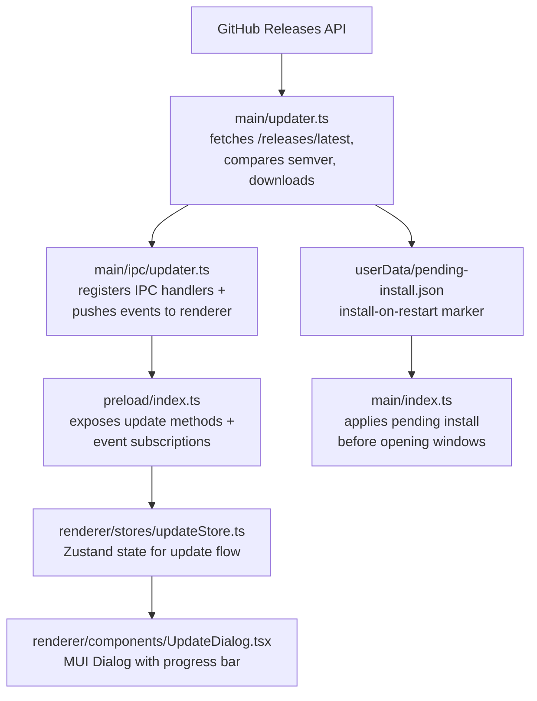

# Gerenciador de atualizações

## Visão geral

O EncodeX usa um gerenciador de atualizações integrado personalizado. Ele consulta a API do GitHub Releases para obter a release mais recente, compara a versão semântica com a do app em execução, seleciona o instalador para a plataforma e a arquitetura atuais e o baixa dentro do app com relatório de progresso. Quando o download é concluído, o usuário pode instalar e reiniciar imediatamente ou agendar o instalador para ser executado na próxima reinicialização do app.

As atualizações nunca são instaladas de forma silenciosa ou automática. Toda instalação é iniciada por uma ação do usuário, seja a partir do diálogo de atualização ou do marcador de instalação pendente que o usuário armou explicitamente.

## Arquitetura

## Arquivos de implementação

| Arquivo | Papel |
|------|---------|
| `src/main/updater.ts` | Busca da release, comparação semver, seleção de assets, download, verificação de checksum, lançamento do instalador, marcador de instalação pendente |
| `src/main/ipc/updater.ts` | Registro dos handlers IPC e encaminhamento dos eventos de atualização |
| `src/shared/types.ts` | Interfaces `UpdateInfo`, `UpdateAsset`, `UpdateProgress` e `PendingInstall` |
| `src/shared/ipc-channels.ts` | Constantes dos canais IPC de atualização |
| `src/shared/log-constants.ts` | Constantes das mensagens de log de atualização |
| `src/main/index.ts` | Executa `autoInstallPendingUpdate()` antes de criar a splash e a janela principal |
| `src/preload/index.ts` | Expõe os métodos da ponte de atualização e as inscrições de eventos |
| `src/renderer/electron-api.d.ts` | Declara os tipos da API de atualização no `ElectronAPI` |
| `src/renderer/stores/updateStore.ts` | Store Zustand para o estado de atualização, o progresso e as instalações pendentes |
| `src/renderer/components/UpdateDialog.tsx` | Diálogo modal para disponibilidade, progresso do download e opções de instalação |
| `src/renderer/styles/UpdateDialog.styles.ts` | Componentes estilizados para o diálogo de atualização |
| `src/renderer/pages/About.tsx` | Botão "Verificar atualizações" e exibição da versão |
| `src/renderer/App.tsx` | Monta o `UpdateDialog` globalmente |
| `src/test-setup.ts`, `e2e/mocks/preload.js` | Mocks da API de atualização para os testes unitários e E2E |

## Canais IPC

| Channel | Direção | Objetivo |
|---------|-----------|---------|
| `check-for-updates` | renderer -> main | Disparar a verificação de atualizações |
| `download-update` | renderer -> main | Iniciar o download do asset correspondente |
| `install-update` | renderer -> main | Lançar o instalador baixado e encerrar o app |
| `cancel-download` | renderer -> main | Cancelar o download em andamento |
| `open-release-notes` | renderer -> main | Abrir a página do release no navegador do sistema |
| `schedule-install-on-restart` | renderer -> main | Gravar um marcador para instalar a atualização baixada na próxima reinicialização |
| `cancel-install-on-restart` | renderer -> main | Remover o marcador de instalação pendente para a próxima reinicialização |
| `get-pending-install` | renderer -> main | Ler o marcador de instalação pendente para a próxima reinicialização, se houver |
| `update-available` | main -> renderer | Notificar que uma nova versão está disponível |
| `update-not-available` | main -> renderer | Notificar que o app está atualizado |
| `update-progress` | main -> renderer | Enviar o progresso do download |
| `update-downloaded` | main -> renderer | Notificar que o download foi concluído |
| `update-error` | main -> renderer | Enviar um erro de atualização |

## Comparação de versões

- Segue a precedência do semver 2.0.0, incluindo os identificadores de pre-release.
- Um `v` inicial e os metadados `+build` são ignorados; os metadados de build não afetam a precedência.
- Major, minor e patch devem ser numéricos; uma versão que não possa ser interpretada gera erro em vez de ser convertida à força.
- Uma versão estável supera uma pre-release (`1.0.0` > `1.0.0-beta.1`).
- Os identificadores de pre-release são comparados ponto a ponto: identificadores numéricos de forma numérica, identificadores alfanuméricos de forma lexicográfica, e os identificadores numéricos ficam abaixo dos alfanuméricos.
- Uma atualização só é oferecida quando a versão remota é estritamente maior que a versão em execução.

## Lógica de seleção de assets

1. Aceitar apenas nomes de arquivo simples com a extensão do instalador da plataforma:
   - `win32` -> `.exe`
   - `darwin` -> `.dmg`
   - `linux` -> `.AppImage`
2. Rejeitar nomes que contenham separadores de caminho, segmentos de travessia ou bytes NUL.
3. Dentro do conjunto da plataforma, preferir o asset cujo nome contenha o `process.arch` atual (`x64`, `arm64`, `ia32`).
4. Recorrer ao primeiro asset correspondente à plataforma quando nenhuma arquitetura corresponder.
5. Fixar os redirecionamentos de download em hosts pertencentes ao GitHub.

## Fluxo de download e instalação

1. O renderer chama `check-for-updates`. O processo principal busca `/releases/latest` com timeout de 15 segundos, limite de resposta de 4 MB e no máximo 5 redirecionamentos.
2. O asset correspondente é devolvido através de `update-available`.
3. `download-update` transmite o instalador para `app.getPath('temp')/EncodeX-updater/`. Downloads são abortados após 60 segundos sem nenhum chunk; tamanhos de asset acima de 4 GB no payload da release são tratados como desconhecidos.
4. O progresso é enviado via `update-progress` no máximo a cada ~300 ms, como `percent`, `transferred` e `total`.
5. Ao concluir, o arquivo precisa corresponder ao `Content-Length` anunciado e, quando a release publica um, ao seu digest SHA-256 ou SHA-512. Uma divergência faz o download falhar.
6. `update-downloaded` informa o caminho do instalador. O usuário pode instalar e reiniciar, agendar a instalação para a próxima reinicialização ou fechar o diálogo.
7. `install-update` revalida que o caminho é um instalador dentro do diretório de atualização, lança-o com `shell.openPath()` e encerra o app.
8. `schedule-install-on-restart` grava `userData/pending-install.json`. Na próxima inicialização, `autoInstallPendingUpdate()` limpa o marcador, revalida o caminho e a versão, lança o instalador e encerra o app antes de abrir qualquer janela.

As releases do EncodeX não têm assinatura de código nem notarização. A verificação do digest confirma a integridade quando o GitHub publica um digest; ela não estabelece a autenticidade de quem publicou.

## Estados da UI

| Estado | O que o diálogo mostra |
|-------|-------------|
| `idle` | Diálogo oculto |
| `checking` | Spinner + "Verificando atualizações..." |
| `available` | Informações da versão, link das notas do release, botão Baixar |
| `not-available` | Mensagem "Você está atualizado", botão Fechar |
| `downloading` | Barra de progresso determinística com porcentagem e bytes transferidos/total |
| `downloaded` | "Atualização pronta para instalar" com as opções Instalar e reiniciar e Instalar ao reiniciar |
| `restart-scheduled` | Aviso de que a atualização será instalada na próxima reinicialização, além de Cancelar e Instalar e reiniciar |
| `error` | Mensagem de erro + botões Tentar novamente / Fechar |

## Estratégia de testes

- Unitários: comparação semver, seleção de assets, validação do download, tratamento de checksum e o marcador de instalação pendente.
- Testes de entradas hostis: `src/main/__tests__/updater-hostile.test.ts` fixa o comportamento para travessia de caminho, redirecionamento, download truncado e divergência de digest.
- Testes de IPC: registro dos handlers e encaminhamento de eventos em `src/main/ipc/__tests__/updater.test.ts`.
- Manuais: publicar um tag/release de teste mais recente que `1.0.0-beta.5` e verificar verificação -> download -> instalação, além do caminho de instalação na próxima reinicialização.
