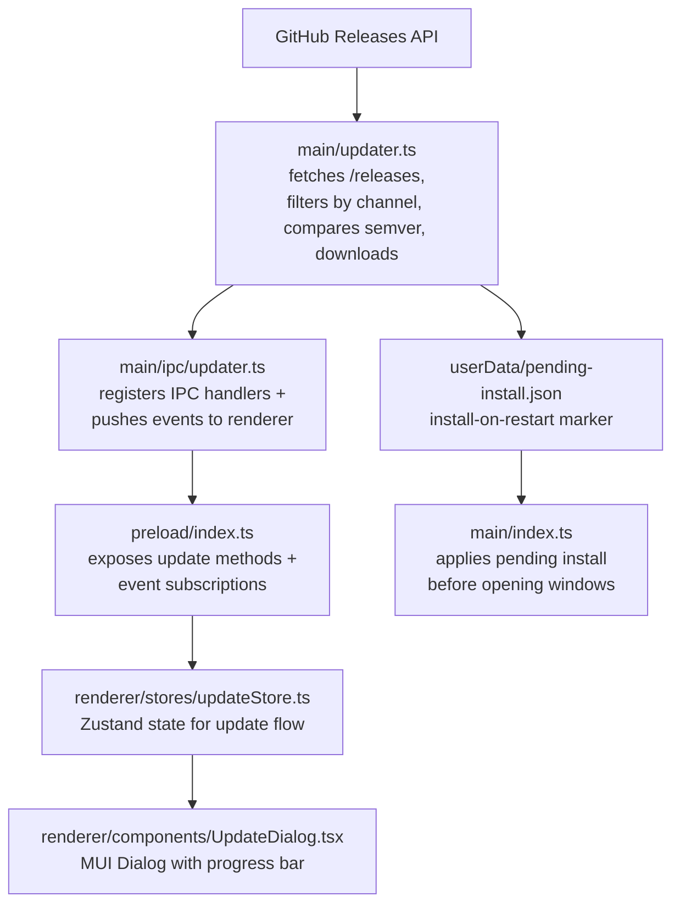

# अपडेट मैनेजर

## अवलोकन

EncodeX एक कस्टम इन-ऐप अपडेट मैनेजर का उपयोग करता है। यह GitHub Releases API से published releases पूछता है, उन्हें चल रहे version के update channel के अनुसार filter करता है, उनके semantic versions की तुलना चल रहे ऐप से करता है, वर्तमान प्लेटफ़ॉर्म और आर्किटेक्चर के लिए installer चुनता है, और उसे ऐप के अंदर real-time progress reporting के साथ डाउनलोड करता है। डाउनलोड पूरा होने पर उपयोगकर्ता तुरंत इंस्टॉल और पुनःप्रारंभ कर सकता है, या अगले पुनःप्रारंभ पर इंस्टॉलर चलाने का शेड्यूल कर सकता है।

अपडेट कभी चुपचाप या अपने-आप इंस्टॉल नहीं होते। हर इंस्टॉल किसी उपयोगकर्ता क्रिया से शुरू होता है — या तो अपडेट डायलॉग से, या उस pending-install marker से जिसे उपयोगकर्ता ने स्पष्ट रूप से सेट किया हो।

## आर्किटेक्चर

## कार्यान्वयन फ़ाइलें

| फ़ाइल                                        | भूमिका                                                                                                      |
| -------------------------------------------- | ----------------------------------------------------------------------------------------------------------- |
| `src/main/updater.ts`                        | रिलीज़ प्राप्ति, semver तुलना, एसेट चयन, डाउनलोड, checksum सत्यापन, इंस्टॉलर लॉन्च, pending-install marker       |
| `src/main/ipc/updater.ts`                    | IPC हैंडलर पंजीकरण और अपडेट इवेंट फ़ॉरवर्डिंग                                                                |
| `src/shared/types.ts`                        | `UpdateInfo`, `UpdateAsset`, `UpdateProgress` और `PendingInstall` इंटरफ़ेस                                  |
| `src/shared/ipc-channels.ts`                 | अपडेट IPC चैनल कॉन्स्टेंट                                                                                   |
| `src/shared/log-constants.ts`                | अपडेट लॉग मैसेज कॉन्स्टेंट                                                                                  |
| `src/main/index.ts`                          | स्प्लैश और मुख्य विंडो बनाने से पहले `autoInstallPendingUpdate()` चलाता है                                    |
| `src/preload/index.ts`                       | अपडेट ब्रिज विधियाँ और इवेंट सब्सक्रिप्शन खोलता है                                                           |
| `src/renderer/electron-api.d.ts`             | `ElectronAPI` पर अपडेट API प्रकार घोषित करता है                                                              |
| `src/renderer/stores/updateStore.ts`         | अपडेट अवस्था, प्रगति और pending installs के लिए Zustand store                                               |
| `src/renderer/components/UpdateDialog.tsx`   | उपलब्धता, डाउनलोड प्रगति और इंस्टॉल विकल्पों के लिए मॉडल डायलॉग                                              |
| `src/renderer/pages/About.tsx`               | "अपडेट जाँचें" बटन और वर्ज़न प्रदर्शन                                                                        |
| `src/renderer/App.tsx`                       | `UpdateDialog` को वैश्विक रूप से माउंट करता है                                                              |
| `src/test-setup.ts`, `e2e/mocks/preload.js`  | यूनिट और E2E परीक्षणों के लिए अपडेट API मॉक                                                                  |

## IPC चैनल

| चैनल                          | दिशा             | उद्देश्य                                                              |
| ----------------------------- | ---------------- | --------------------------------------------------------------------- |
| `check-for-updates`           | renderer -> main | अपडेट जाँच ट्रिगर करें                                                |
| `download-update`             | renderer -> main | मिलान किए गए एसेट का डाउनलोड शुरू करें                                 |
| `install-update`              | renderer -> main | डाउनलोड किया गया इंस्टॉलर लॉन्च करें और ऐप बंद करें                       |
| `cancel-download`             | renderer -> main | चल रहे डाउनलोड को रद्द करें                                           |
| `open-release-notes`          | renderer -> main | सिस्टम ब्राउज़र में रिलीज़ पेज खोलें                                   |
| `schedule-install-on-restart` | renderer -> main | अगले पुनःप्रारंभ पर डाउनलोड किया गया अपडेट इंस्टॉल करने के लिए marker सहेजें |
| `cancel-install-on-restart`   | renderer -> main | पुनःप्रारंभ-इंस्टॉल का pending marker हटाएँ                             |
| `get-pending-install`         | renderer -> main | मौजूद pending पुनःप्रारंभ-इंस्टॉल marker पढ़ें                          |
| `update-available`            | main -> renderer | सूचित करें कि नया वर्ज़न उपलब्ध है                                     |
| `update-not-available`        | main -> renderer | सूचित करें कि ऐप अप-टू-डेट है                                         |
| `update-progress`             | main -> renderer | डाउनलोड प्रगति भेजें                                                  |
| `update-downloaded`           | main -> renderer | सूचित करें कि डाउनलोड पूरा हो गया                                      |
| `update-error`                | main -> renderer | अपडेट त्रुटि भेजें                                                    |

## वर्ज़न तुलना

- Semver 2.0.0 precedence का पालन होता है, pre-release identifiers सहित।
- अग्रणी `v` और `+build` मेटाडेटा अनदेखा किए जाते हैं; build metadata precedence को प्रभावित नहीं करता।
- Major, minor और patch अंकीय होने चाहिए; न पढ़ा जा सकने वाला वर्ज़न बदलकर नहीं, बल्कि त्रुटि फेंककर अस्वीकार होता है।
- स्थिर वर्ज़न pre-release से ऊपर रैंक करता है (`1.0.0` > `1.0.0-beta.1`)।
- Pre-release identifiers dot-by-dot तुलना होते हैं: अंकीय identifiers संख्यात्मक रूप से, अक्षरांकीय identifiers lexically, और अंकीय identifiers अक्षरांकीय से नीचे रैंक होते हैं।
- अपडेट केवल तभी दिया जाता है जब रिमोट वर्ज़न चल रहे वर्ज़न से सख्ती से बड़ा हो।

## अपडेट चैनल

चैनल चल रहे वर्ज़न से derive होता है और यह तय करता है कि कौन-सी releases eligible हैं:

| चैनल | चल रहा वर्ज़न | Eligible releases |
|---|---|---|
| `stable` | कोई pre-release identifier नहीं, जैसे `1.0.0` | केवल stable releases |
| `beta` | एक pre-release identifier, जैसे `1.0.0-beta.5` | pre-releases *और* stable releases |

जानने योग्य परिणाम:

- Beta build को betas मिलते रहते हैं, और stable `1.0.0` आने पर उसे वह भी मिल जाता है।
- Stable build को कभी कोई pre-release offer नहीं होता।
- **Draft** release किसी को भी offer नहीं होता। GitHub published release list से drafts को बाहर रखता है, इसलिए draft में छोड़ा गया release updater के लिए publish होने तक अदृश्य रहता है।
- GitHub का अपना "latest release" endpoint जानबूझकर *नहीं* इस्तेमाल किया जाता: यह सबसे नया non-draft, non-prerelease release पर resolve होता है, जिसे कोई beta build कभी पार नहीं कर सकता, और बिना pre-release flag के publish किया गया beta stable users को stable release की तरह मिल जाएगा। Updater release की **list** पढ़ता है और channel filter खुद लागू करता है।
- Release workflow एक pre-release tag (`v1.0.0-beta.6`) को GitHub pre-release के रूप में चिह्नित करता है, ताकि flag और tag आपस में मेल खाएँ।

## एसेट चयन लॉजिक

1. केवल सादे फ़ाइल नाम स्वीकार करें जिनमें प्लेटफ़ॉर्म का इंस्टॉलर एक्सटेंशन हो:
   - `win32` -> `.exe`
   - `darwin` -> `.dmg`
   - `linux` -> `.AppImage`
2. ऐसे फ़ाइल नाम अस्वीकार करें जिनमें path separators, traversal segments या NUL bytes हों।
3. प्लेटफ़ॉर्म सेट के भीतर ऐसे एसेट को प्राथमिकता दें जिसके नाम में वर्तमान `process.arch` (`x64`, `arm64`, `ia32`) हो।
4. आर्किटेक्चर मिलान न होने पर प्लेटफ़ॉर्म से मेल खाने वाले पहले एसेट पर फ़ॉलबैक करें।
5. डाउनलोड redirects को GitHub-स्वामित्व वाले hosts तक सीमित रखें।

## डाउनलोड और इंस्टॉल प्रवाह

1. Renderer `check-for-updates` कॉल करता है। मुख्य प्रक्रिया `/releases?per_page=100` को 15-सेकंड timeout, 4 MB response cap और अधिकतम 5 redirects के साथ लाती है और फिर list को update channel के अनुसार filter करती है।
2. मेल खाने वाला एसेट `update-available` के माध्यम से लौटाया जाता है।
3. `download-update` इंस्टॉलर को `app.getPath('temp')/EncodeX-updater/` में स्ट्रीम करता है। 60 सेकंड तक कोई chunk न आने पर डाउनलोड रुक जाता है; रिलीज़ payload में 4 GB से बड़े एसेट साइज़ को अज्ञात माना जाता है।
4. प्रगति `update-progress` के माध्यम से लगभग हर 300 ms पर `percent`, `transferred` और `total` के रूप में भेजी जाती है।
5. पूरा होने पर फ़ाइल विज्ञापित `Content-Length` से मेल खानी चाहिए और, यदि रिलीज़ उसे प्रकाशित करता है, तो उसके SHA-256 या SHA-512 digest से भी। मिलान न होने पर डाउनलोड विफल होता है।
6. `update-downloaded` इंस्टॉलर का पथ रिपोर्ट करता है। उपयोगकर्ता इंस्टॉल और पुनःप्रारंभ कर सकता है, इंस्टॉल को अगले पुनःप्रारंभ के लिए शेड्यूल कर सकता है, या डायलॉग बंद कर सकता है।
7. `install-update` जाँचता है कि पथ अपडेट डायरेक्टरी के भीतर का एक इंस्टॉलर है, उसे `shell.openPath()` से लॉन्च करता है, और ऐप बंद करता है।
8. `schedule-install-on-restart` `userData/pending-install.json` लिखता है। अगले स्टार्टअप पर `autoInstallPendingUpdate()` marker हटाता है, पथ और वर्ज़न फिर से validate करता है, इंस्टॉलर लॉन्च करता है, और कोई विंडो खुलने से पहले बंद हो जाता है।

EncodeX रिलीज़ code-signed या notarized नहीं हैं। Digest जाँच तब integrity सत्यापित करती है जब GitHub digest प्रकाशित करता है; यह प्रकाशक की authenticity स्थापित नहीं करती।

Windows पर डाउनलोड किया गया इंस्टॉलर चलाने पर SmartScreen "Windows protected your PC" चेतावनी के साथ "Unknown publisher" संदेश दिखा सकता है। unsigned build के लिए यह अपेक्षित है और इसका मतलब नहीं कि डाउनलोड खराब है; उपयोगकर्ता **More info** और फिर **Run anyway** पर क्लिक करता है। बिल्ड में code signature न होने के कारण SmartScreen भी publisher की authenticity स्थापित नहीं कर सकता। macOS पर पहली बार चलाने पर यही अवरोध Gatekeeper देता है: ऐप पर right-click करके **Open** चुनें (या `xattr -cr /Applications/EncodeX.app` से quarantine हटाएँ)।

## UI अवस्थाएँ

| अवस्था              | डायलॉग दिखाता है                                                                                   |
| ------------------- | -------------------------------------------------------------------------------------------------- |
| `idle`              | डायलॉग छिपा हुआ                                                                                    |
| `checking`          | स्पिनर + "अपडेट जाँचे जा रहे हैं..."                                                              |
| `available`         | वर्ज़न जानकारी, रिलीज़ नोट्स लिंक, डाउनलोड बटन                                                       |
| `not-available`     | "आप अप-टू-डेट हैं" संदेश, बंद बटन                                                                   |
| `downloading`       | प्रतिशत और transferred/total बाइट्स के साथ निश्चित प्रगति पट्टी                                       |
| `downloaded`        | "अपडेट इंस्टॉल करने के लिए तैयार" + इंस्टॉल और पुनःप्रारंभ तथा अगले पुनःप्रारंभ पर इंस्टॉल विकल्प           |
| `restart-scheduled` | सूचना कि अपडेट अगले पुनःप्रारंभ पर इंस्टॉल होगा, साथ में रद्द करें और इंस्टॉल और पुनःप्रारंभ बटन            |
| `error`             | त्रुटि संदेश + पुनः प्रयास / बंद बटन                                                                |

## परीक्षण रणनीति

- यूनिट: semver तुलना, update-channel चयन, एसेट चयन, डाउनलोड सत्यापन, checksum हैंडलिंग और pending-install marker।
- Hostile-input परीक्षण: `src/main/__tests__/updater-hostile.test.ts` path traversal, redirect, अधूरे डाउनलोड और digest mismatch के व्यवहार को पिन करता है।
- IPC परीक्षण: `src/main/ipc/__tests__/updater.test.ts` में हैंडलर पंजीकरण और इवेंट फ़ॉरवर्डिंग।
- मैनुअल: `1.0.0-beta.5` से नया टैग **pre-release** के रूप में प्रकाशित करें, draft को प्रकाशित करके draft state से बाहर निकालें, और जाँच -> डाउनलोड -> इंस्टॉल प्रवाह के साथ install-on-restart पथ भी सत्यापित करें। फिर stable build से सत्यापित करें कि वही pre-release *नहीं* दिया जाता।
