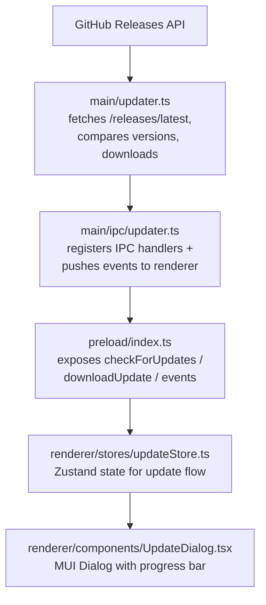

# Gerenciador de atualizacoes

## Visao geral

Implementa um gerenciador de atualizacoes integrado personalizado que verifica o GitHub Releases em busca de novas versoes, notifica o usuario, baixa o instalador especifico da plataforma dentro do app com relatório de progresso e lança o instalador ao concluir. O instalador tambem pode ser agendado para a proxima reinicializacao.

## Arquitetura

## Arquivos de implementacao

| Arquivo | Funcao |
|------|------|
| `src/main/updater.ts` | Busca de releases, comparação semver, seleção de asset, download, verificação de checksum, lançamento do instalador, marcador de instalação pendente |
| `src/main/ipc/updater.ts` | Registro dos handlers IPC e encaminhamento de eventos de atualizacao |
| `src/shared/types.ts` | Interfaces `UpdateInfo`, `UpdateAsset`, `UpdateProgress` e `PendingInstall` |
| `src/shared/ipc-channels.ts` | Constantes dos canais IPC de atualizacao |
| `src/shared/log-constants.ts` | Constantes das mensagens de log de atualizacao |
| `src/main/index.ts` | Executa `autoInstallPendingUpdate()` antes de criar as janelas splash e principal |
| `src/preload/index.ts` | Expoe os metodos da ponte de atualizacao e as inscricoes de eventos |
| `src/renderer/electron-api.d.ts` | Declara os tipos da API de atualizacao no `ElectronAPI` |
| `src/renderer/stores/updateStore.ts` | Store Zustand para o estado de atualizacao, progresso e instalações pendentes |
| `src/renderer/components/UpdateDialog.tsx` | Dialogo modal para disponibilidade, progresso do download e opções de instalacao |
| `src/renderer/styles/UpdateDialog.styles.ts` | Componentes estilizados para o diálogo de atualizacao |
| `src/renderer/pages/About.tsx` | Botao "Verificar atualizacoes" e exibicao da versao |
| `src/renderer/App.tsx` | Monta o `UpdateDialog` globalmente |
| `src/test-setup.ts`, `e2e/mocks/preload.js` | Mocks da API de atualizacao para testes unitarios e E2E |

## Canais IPC

| Channel | Direcao | Objetivo |
|---------|-----------|---------|
| `check-for-updates` | renderer -> main | Disparar a verificação de atualizacoes |
| `download-update` | renderer -> main | Iniciar o download do asset correspondente |
| `install-update` | renderer -> main | Lancar o instalador baixado e sair |
| `cancel-download` | renderer -> main | Cancelar o download em andamento |
| `open-release-notes` | renderer -> main | Abrir a pagina do release no navegador do sistema |
| `schedule-install-on-restart` | renderer -> main | Persistir um marcador para instalar a atualizacao baixada na proxima reinicializacao |
| `cancel-install-on-restart` | renderer -> main | Remover o marcador de instalacao na proxima reinicializacao |
| `get-pending-install` | renderer -> main | Ler o marcador de instalação pendente, se existir |
| `update-available` | main -> renderer | Notificar que uma nova versao esta disponível |
| `update-not-available` | main -> renderer | Notificar que o app esta atualizado |
| `update-progress` | main -> renderer | Enviar o progresso do download |
| `update-downloaded` | main -> renderer | Notificar que o download foi concluído |
| `update-error` | main -> renderer | Enviar um erro de atualizacao |

## Comparacao de versoes

- Segue a precedencia do semver 2.0.0, incluindo identificadores pre-lançamento.
- Um `v` inicial e metadados `+build` sao ignorados; metadados de build nao afetam a precedencia.
- Major, minor e patch devem ser numericos; uma versao nao analisavel gera erro.
- Uma versao estavel tem precedencia sobre uma pre-lançamento (`1.0.0` > `1.0.0-beta.1`).
- Identificadores pre-lançamento sao comparados ponto a ponto: numericos numericamente, alfanumericos lexicamente, e identificadores numericos tem precedencia inferior aos alfanumericos.
- Uma atualizacao so e oferecida quando a versao remota for estritamente maior que a versao em execucao.

## Logica de seleção de assets

1. Aceitar apenas nomes de arquivo simples com a extensao do instalador da plataforma:
   - `win32` -> `.exe`
   - `darwin` -> `.dmg`
   - `linux` -> `.AppImage`
2. Rejeitar nomes contendo separadores de caminho, segmentos de travessia ou bytes NUL.
3. Dentro do conjunto da plataforma, preferir um asset cujo nome contenha `process.arch` atual (`x64`, `arm64`, `ia32`).
4. Recorrer ao primeiro asset correspondente a plataforma quando nao houver correspondencia de arquitetura.
5. Fixar redirecionamentos de download para hosts pertencentes ao GitHub.

## Fluxo de download e instalacao

1. O renderer chama `check-for-updates`. O processo principal busca `/releases/latest` com tempo limite de 15 segundos, limite de resposta de 4 MB e no máximo 5 redirecionamentos.
2. O asset correspondente e retornado por meio de `update-available`.
3. `download-update` transmite o instalador para `app.getPath('temp')/EncodeX-updater/`. Os downloads sao abortados apos 60 segundos sem um chunk; tamanhos de asset acima de 4 GB no payload de release sao tratados como desconhecidos.
4. O progresso e enviado via `update-progress` no máximo a cada ~300 ms como `percent`, `transferred` e `total`.
5. Ao concluir, o arquivo deve corresponder ao `Content-Length` anunciado e, quando o release publicar um, ao digest SHA-256 ou SHA-512. Uma incompatibilidade falha o download.
6. `update-downloaded` reporta o caminho do instalador. O usuario pode instalar e reiniciar, agendar a instalacao para a proxima reinicializacao ou fechar o diálogo.
7. `install-update` revalida que o caminho e um instalador dentro do diretorio de atualizacao, lança-o com `shell.openPath()` e sai do app.
8. `schedule-install-on-restart` grava `userData/pending-install.json`. Na proxima inicializacao, `autoInstallPendingUpdate()` limpa o marcador, revalida o caminho e a versao, lança o instalador e sai antes que qualquer janela seja aberta.

As releases do EncodeX nao sao assinadas digitalmente. A verificação de digest verifica a integridade quando o GitHub publica um digest; ela nao estabelece a autenticidade do editor.

## Estados da UI

| Estado | O que o diálogo mostra |
|-------|-------------|
| `idle` | Dialogo oculto |
| `checking` | Spinner + "Verificando atualizacoes..." |
| `available` | Informacoes da versao, link das notas do release, botao Baixar |
| `not-available` | Mensagem "Voce esta atualizado", botao Fechar |
| `downloading` | Barra de progresso determinística com porcentagem e bytes transferidos/total |
| `downloaded` | "Atualizacao pronta para instalar" com opções Instalar e reiniciar e Instalar na proxima reinicializacao |
| `restart-scheduled` | Aviso de que a atualizacao sera instalada na proxima reinicializacao, com botoes Cancelar e Instalar e reiniciar |
| `error` | Mensagem de erro + botoes Tentar novamente / Fechar |

## Estratégia de testes

- Unitários: comparação semver, seleção de assets, validacao de download, tratamento de checksum e o marcador de instalação pendente.
- Testes de entrada hostil: `src/main/__tests__/updater-hostile.test.ts` fixa comportamentos de travessia de caminho, redirecionamento, download truncado e incompatibilidade de digest.
- Testes IPC: registro de handlers e encaminhamento de eventos em `src/main/ipc/__tests__/updater.test.ts`.
- Manuais: publicar um tag de teste mais recente que `1.0.0-beta.5` e verificar o fluxo verificação -> download -> instalacao, alem do caminho de instalacao na proxima reinicializacao.
