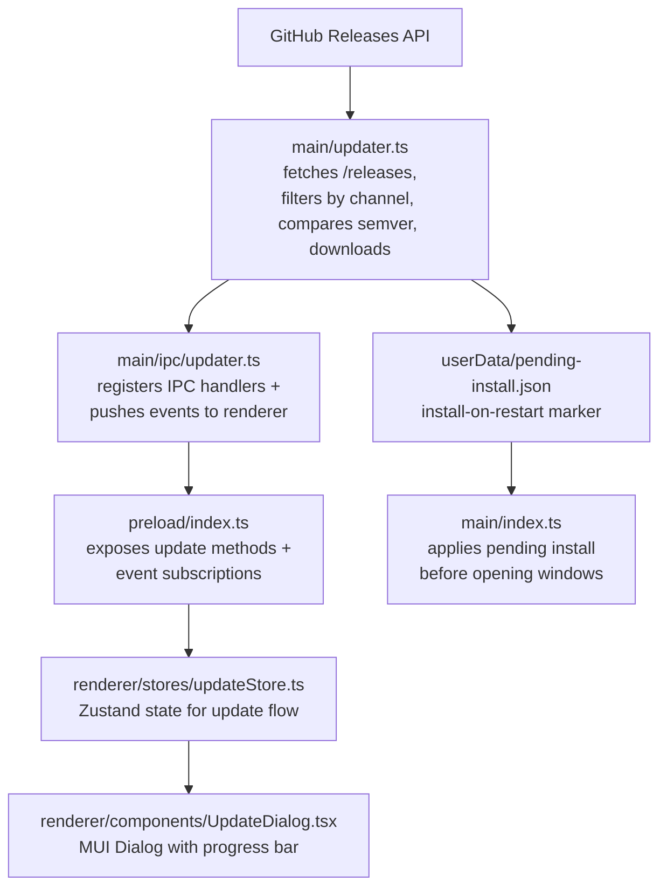

# 更新管理器

## 概述

EncodeX 使用自定义的应用内更新管理器。它查询 GitHub Releases API 获取已发布的 release，按当前运行版本所属的更新渠道对其过滤，再将其语义化版本与正在运行的应用进行比较，为当前平台和架构选择安装程序，并在应用内下载且实时报告进度。下载完成后，用户可以立即安装并重启，也可以安排在下次应用重启时安装。

更新绝不会静默安装。每次安装都由用户操作发起，可以是更新对话框中的操作，也可以是用户明确启用的重启安装标记。

## 架构

## 实现文件

| 文件 | 职责 |
|------|------|
| `src/main/updater.ts` | release 获取、语义化版本比较、资产选择、下载、校验和验证、启动安装程序、重启安装标记 |
| `src/main/ipc/updater.ts` | IPC 处理器注册和更新事件转发 |
| `src/shared/types.ts` | `UpdateInfo`、`UpdateAsset`、`UpdateProgress` 和 `PendingInstall` 接口 |
| `src/shared/ipc-channels.ts` | 更新 IPC 通道常量 |
| `src/shared/log-constants.ts` | 更新日志消息常量 |
| `src/main/index.ts` | 在创建 splash 和主窗口之前运行 `autoInstallPendingUpdate()` |
| `src/preload/index.ts` | 暴露更新桥接方法和事件订阅 |
| `src/renderer/electron-api.d.ts` | 在 `ElectronAPI` 上声明更新 API 类型 |
| `src/renderer/stores/updateStore.ts` | 更新状态、进度和待安装标记的 Zustand store |
| `src/renderer/components/UpdateDialog.tsx` | 显示可用性、下载进度和安装选项的模态对话框 |
| `src/renderer/styles/UpdateDialog.styles.ts` | 更新对话框的样式组件 |
| `src/renderer/pages/About.tsx` | "检查更新"按钮和版本显示 |
| `src/renderer/App.tsx` | 全局挂载 `UpdateDialog` |
| `src/test-setup.ts`、`e2e/mocks/preload.js` | 单元测试和 E2E 测试的更新 API mock |

## IPC 通道

| 通道 | 方向 | 用途 |
|---------|-----------|---------|
| `check-for-updates` | renderer -> main | 触发更新检查 |
| `download-update` | renderer -> main | 开始下载匹配的资产 |
| `install-update` | renderer -> main | 启动已下载的安装程序并退出 |
| `cancel-download` | renderer -> main | 取消进行中的下载 |
| `open-release-notes` | renderer -> main | 在系统浏览器中打开 release 页面 |
| `schedule-install-on-restart` | renderer -> main | 持久化标记，以便在下次重启时安装已下载的更新 |
| `cancel-install-on-restart` | renderer -> main | 移除待重启安装标记 |
| `get-pending-install` | renderer -> main | 读取待重启安装标记（如果存在） |
| `update-available` | main -> renderer | 通知有新版本可用 |
| `update-not-available` | main -> renderer | 通知应用已是最新 |
| `update-progress` | main -> renderer | 推送下载进度 |
| `update-downloaded` | main -> renderer | 通知下载已完成 |
| `update-error` | main -> renderer | 推送更新错误 |

## 版本比较

- 遵循 semver 2.0.0 优先级规则，包括预发布标识符。
- 忽略前导 `v` 和 `+build` 元数据；构建元数据不影响优先级。
- 主版本、次版本和修订号必须为数字；无法解析的版本会抛出错误，而不会被强制转换。
- 稳定版本优先于预发布版本（`1.0.0` > `1.0.0-beta.1`）。
- 预发布标识符按点分段逐一比较：数字标识符按数值比较，字母数字标识符按字典序比较，数字标识符的优先级低于字母数字标识符。
- 仅当远程版本严格大于正在运行的版本时才会提供更新。

## 更新渠道

更新渠道由当前运行的版本推导得出，并决定哪些 release 可以被提供：

| 渠道 | 当前运行版本 | 可提供的 release |
|---|---|---|
| `stable` | 没有预发布标识符，例如 `1.0.0` | 仅稳定版 release |
| `beta` | 含预发布标识符，例如 `1.0.0-beta.5` | 预发布版 *和* 稳定版 release |

值得注意的影响：

- beta 构建会持续收到 beta 版本，并在稳定版 `1.0.0` 发布后同样收到它。
- 稳定版构建永远不会被提供预发布版本。
- **草稿**（draft）release 不会提供给任何人。GitHub 会将草稿排除在已发布的 release 列表之外，因此以草稿状态保留的 release 在发布之前对更新器不可见。
- 刻意*不*使用 GitHub 自带的「最新 release」接口：它会解析到最新的非草稿、非预发布 release，beta 构建永远无法越过它；而一个未带预发布标记发布的 beta 会被当作稳定版 release 提供给稳定版用户。更新器读取的是 release **列表**，并自行应用渠道过滤。
- 发布工作流会将预发布 tag（`v1.0.0-beta.6`）标记为 GitHub 预发布，使标记与 tag 保持一致。

## 资产选择逻辑

1. 只接受纯文件名且带有平台安装程序扩展名的资产：
   - `win32` -> `.exe`
   - `darwin` -> `.dmg`
   - `linux` -> `.AppImage`
2. 拒绝包含路径分隔符、路径遍历片段或 NUL 字节的名称。
3. 在平台匹配的集合中，优先选择文件名包含当前 `process.arch`（`x64`、`arm64`、`ia32`）的资产。
4. 若不存在架构匹配项，回退到第一个匹配平台的资产。
5. 将下载重定向限制在 GitHub 所属的主机上。

## 下载与安装流程

1. renderer 调用 `check-for-updates`。主进程获取 `/releases?per_page=100`，超时时间为 15 秒，响应上限为 4 MB，最多 5 次重定向，然后按更新渠道过滤该列表。
2. 匹配的资产通过 `update-available` 返回。
3. `download-update` 将安装程序流式写入 `app.getPath('temp')/EncodeX-updater/`。若超过 60 秒没有收到数据块，下载将中止；release 数据中超过 4 GB 的资产大小被视为未知。
4. 进度通过 `update-progress` 推送，大约每 300 ms 一次，包含 `percent`、`transferred` 和 `total`。
5. 下载完成时，文件必须与公布的 `Content-Length` 一致；若 release 发布了 SHA-256 或 SHA-512 摘要，文件还必须与之匹配。不匹配则下载失败。
6. `update-downloaded` 报告安装程序路径。用户可以安装并重启、安排在下次重启时安装，或关闭对话框。
7. `install-update` 会重新验证该路径是否为更新目录内的安装程序，通过 `shell.openPath()` 启动它，并退出应用。
8. `schedule-install-on-restart` 写入 `userData/pending-install.json`。下次启动时，`autoInstallPendingUpdate()` 会清除标记，重新验证路径和版本，启动安装程序，并在任何窗口打开之前退出。

EncodeX 发布版本未进行代码签名或公证。当 GitHub 公布摘要时，摘要校验可验证完整性；它并不能证明发布者的真实性。

在 Windows 上，运行下载的安装程序时可能会出现 SmartScreen 警告「Windows protected your PC」和「未知发布者」信息。对于未签名的构建来说这是预期现象，并不表示下载已损坏；用户点击**更多信息**，然后点击**仍要运行**。由于构建没有代码签名，SmartScreen 同样无法确认发布者身份。在 macOS 上，首次启动时的对应拦截来自 Gatekeeper：右键点击应用并选择**打开**（或用 `xattr -cr /Applications/EncodeX.app` 移除隔离属性）。

## UI 状态

| 状态 | 对话框显示内容 |
|-------|-------------|
| `idle` | 对话框隐藏 |
| `checking` | 加载指示器 + "正在检查更新..." |
| `available` | 版本信息、release 说明链接、下载按钮 |
| `not-available` | "已是最新版本"消息、关闭按钮 |
| `downloading` | 确定性进度条，显示百分比和已传输/总字节数 |
| `downloaded` | "更新已就绪可安装"，并提供安装并重启和重启时安装两个选项 |
| `restart-scheduled` | 提示更新将在下次重启时安装，并提供取消和安装并重启按钮 |
| `error` | 错误消息 + 重试/关闭按钮 |

## 测试策略

- 单元测试：语义化版本比较、更新渠道选择、资产选择、下载验证、校验和处理以及待安装标记。
- 恶意输入测试：`src/main/__tests__/updater-hostile.test.ts` 固定了路径遍历、重定向、截断下载和摘要不匹配的行为。
- IPC 测试：`src/main/ipc/__tests__/updater.test.ts` 中的处理器注册和事件转发。
- 手动测试：发布一个高于 `1.0.0-beta.5` 的测试 tag 并将其标记为**预发布**，发布草稿使其脱离草稿状态，并验证检查 -> 下载 -> 安装流程，以及重启时安装路径。然后从稳定版构建验证同一个预发布版本*不会*被提供。
